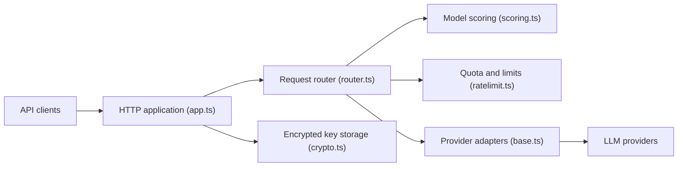

# tashfeenahmed/freellmapi

> A local router compatible with OpenAI that aggregates the free tiers from dozens of LLM providers behind a single `/v1` endpoint.

## The problem
Each free tier has limitations; manually stacking them requires managing dozens of SDKs, quotas, and potential failure points.

## What it actually does
A Node server with SQLite: you add your keys (encrypted using AES-256-GCM), a router selects a healthy model within the RPM/RPD/TPM/TPD limits, switches to the next one if a 429/5xx error occurs, and exposes the OpenAI, Anthropic Messages, Gemini, and Ollama APIs, as well as an MCP server and a dashboard. A signed catalog is updated from freellmapi.co.

## How it is wired


## Trying it
```bash
curl -fsSL https://freellmapi.co/install.sh | bash
npx freellmapi setup-claude --url http://localhost:3001 --api-key <unified-key>
```

## Cost and gotchas
The basic router functionality is free, but access to the "live" catalog costs $19 per year or $49 for a lifetime subscription; the free version receives the models 30 days later. A separate account is required with each provider. The terms of service of each provider always apply to proxified traffic.

## What it is not
Not for production use: the README states ("personal experimentation"), without any Service Level Agreement (SLA) or advanced models. The 7.4 billion tokens per month is a listed capacity, not a guarantee. The level of intelligence varies depending on the usage of the quotas.

## Alternatives
- No alternative is specified in the README.

## For you
Things to watch out for: excellent for prototyping at a low cost, but using free proxies may violate the terms of service provided by vendors; keep it separate from the production process.
