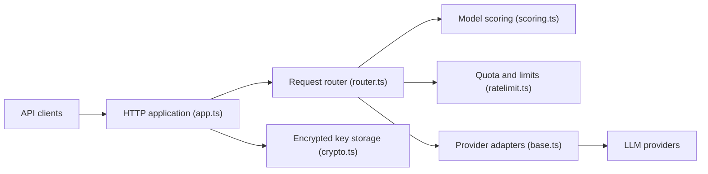

# tashfeenahmed/freellmapi

> Routeur local compatible OpenAI qui agrège les paliers gratuits de dizaines de fournisseurs LLM derrière un seul `/v1`.

## Le problème
Chaque palier gratuit est limité ; les empiler à la main impose des dizaines de SDK, de quotas et de points de défaillance.

## Ce que ça fait vraiment
Un serveur Node avec SQLite : tu ajoutes tes clés (chiffrées AES-256-GCM), un routeur choisit un modèle sain sous les limites RPM/RPD/TPM/TPD, bascule sur le suivant en cas de 429/5xx, et expose les API OpenAI, Anthropic Messages, Gemini et Ollama, plus un serveur MCP et un tableau de bord. Un catalogue signé se met à jour depuis freellmapi.co.

## Comment c'est branché


## Essayer
```bash
curl -fsSL https://freellmapi.co/install.sh | bash
npx freellmapi setup-claude --url http://localhost:3001 --api-key <unified-key>
```

## Coût et pièges
Gratuit côté routeur, mais un accès « live » au catalogue coûte 19 $/an ou 49 $ à vie ; la version gratuite reçoit les modèles 30 jours plus tard. Il faut un compte chez chaque fournisseur. Les conditions d'utilisation des fournisseurs s'appliquent toujours au trafic proxifié.

## Ce que ce n'est pas
Pas pour la production : le README le dit (« expérimentation personnelle »), sans SLA ni modèles de pointe. Les 7,4 milliards de tokens par mois sont une capacité listée, pas garantie. Niveau d'intelligence variable selon la saturation des quotas.

## Alternatives
- Aucune alternative nommée dans le README.

## Pour toi
À surveiller : pratique pour prototyper à coût nul, mais l'usage de paliers gratuits via un proxy peut contrevenir aux conditions des fournisseurs ; garde-le hors du chemin de production.

