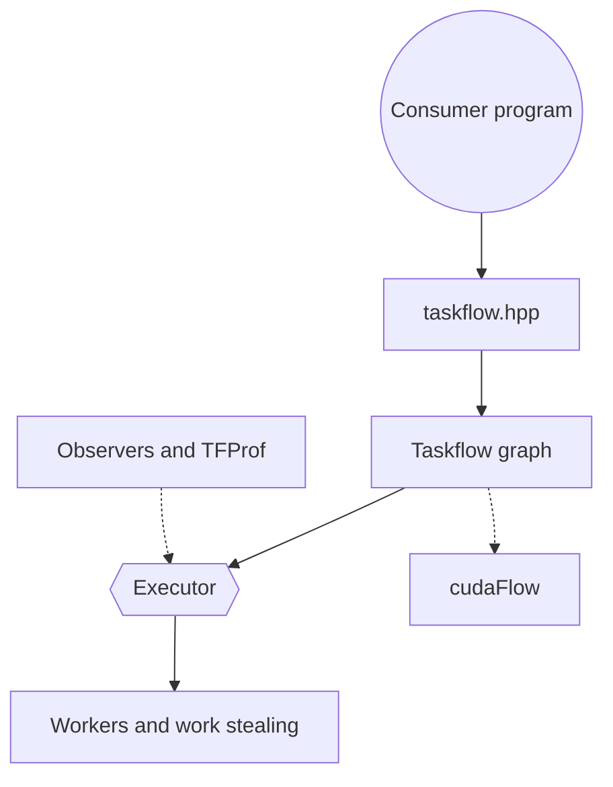

# taskflow/taskflow

> Header-only C++ library for expressing parallel task graphs, on CPU and CUDA GPU.

## The problem
Writing parallelism with dependencies, loops and subgraphs by hand with threads is slow and fragile.

## What it actually does
You build a `tf::Taskflow` (tasks and dependencies) and a `tf::Executor` runs it with work stealing between threads. It handles subgraphs, conditional tasks, composition, asynchronous tasks, parallel algorithms (for_each, reduce, sort), pipelines and CUDA graphs. A profiler, TFProf, visualizes the execution.

## How it is wired


## Trying it
```bash
git clone https://github.com/taskflow/taskflow.git
g++ -std=c++20 simple.cpp -I taskflow/ -O2 -pthread -o simple
./simple
```

## Cost and gotchas
Free. It needs a C++20 compiler (not in the prerequisites list) and, for the GPU, the CUDA Toolkit. The license is present but not identified by GitHub.

## What it is not
Not a data pipeline orchestrator like Airflow: it is parallelism inside a single C++ program.

## Alternatives
No alternative named in the README (it compares itself to existing libraries without naming them).

## For you
Worth watching: relevant only if you write C++ or CUDA compute code; for Python MLOps it brings nothing directly.
