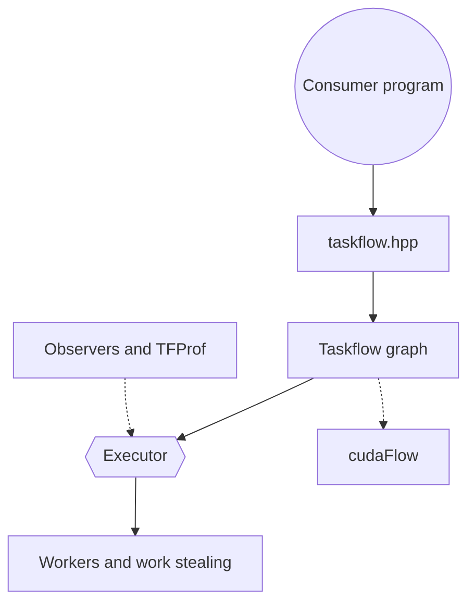

# taskflow/taskflow

> Bibliothèque C++ header-only pour exprimer des graphes de tâches parallèles, CPU et GPU CUDA.

## Le problème
Écrire du parallélisme avec des dépendances, des boucles et des sous-graphes à la main avec des threads est long et fragile.

## Ce que ça fait vraiment
On construit un `tf::Taskflow` (tâches et dépendances) puis un `tf::Executor` l'exécute avec vol de tâches entre threads. Elle gère sous-graphes, tâches conditionnelles, composition, tâches asynchrones, algorithmes parallèles (for_each, reduce, sort), pipelines et graphes CUDA. Un profileur, TFProf, visualise l'exécution.

## Comment c'est branché


## Essayer
```bash
git clone https://github.com/taskflow/taskflow.git
g++ -std=c++20 simple.cpp -I taskflow/ -O2 -pthread -o simple
./simple
```

## Coût et pièges
Gratuit. Il faut un compilateur C++20 (hors liste de prérequis) et, pour le GPU, la CUDA Toolkit. La licence est présente mais non identifiée par GitHub.

## Ce que ce n'est pas
Pas un orchestrateur de pipelines de données de type Airflow : c'est du parallélisme dans un seul programme C++.

## Alternatives
Aucune alternative nommée dans le README (il se compare à des bibliothèques existantes sans les citer).

## Pour toi
À surveiller : pertinent seulement si tu écris du calcul C++ ou CUDA ; pour du MLOps Python, il n'apporte rien directement.

