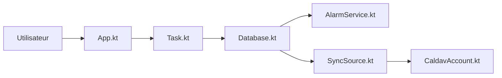

# tasks/tasks

> Task management app derived from Astrid, for Android, desktop (alpha) and Pebble watches.

## The problem
A free, cross-platform task manager, after Astrid shut down in 2013.

## What it actually does
The source code of Astrid's Android app serves as the base. According to the code: task lists and editing, local database, alarms and notifications, location reminders, backup, CalDAV account sync with OAuth, a query API, a watch service and a desktop-side MCP server. Not all internal links were verified.

## How it is wired

## Trying it
No documented command: install via Google Play, F-Droid or the tasks.org site.

## Cost and gotchas
Free. Release signatures are published in the README for verification. Over 1,200 open issues.

## What it is not
Not a collaborative team tool as described in the README: it is a personal manager.

## Alternatives
No alternative named in the README.

## For you
Ignore: consumer app unrelated to data/AI/MLOps, except for personal use.
