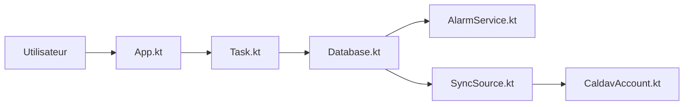

# tasks/tasks

> Application de gestion de tâches issue d'Astrid, pour Android, bureau (alpha) et montres Pebble.

## Le problème
Un gestionnaire de tâches libre et multiplateforme, après l'arrêt d'Astrid en 2013.

## Ce que ça fait vraiment
Le code source de l'app Android d'Astrid sert de base. D'après le code : listes et édition de tâches, base de données locale, alarmes et notifications, rappels de lieu, sauvegarde, synchronisation de comptes CalDAV avec OAuth, API de requêtes, service pour montre et un serveur MCP côté bureau. Les liens internes n'ont pas tous été vérifiés.

## Comment c'est branché

## Essayer
Aucune commande documentée : installation via Google Play, F-Droid ou le site tasks.org.

## Coût et pièges
Gratuit. Les signatures de version sont publiées dans le README pour vérification. Plus de 1 200 issues ouvertes.

## Ce que ce n'est pas
Pas un outil collaboratif d'équipe décrit dans le README : c'est un gestionnaire personnel.

## Alternatives
Aucune alternative nommée dans le README.

## Pour toi
À ignorer : application grand public sans lien avec data/IA/MLOps, sauf usage perso.

