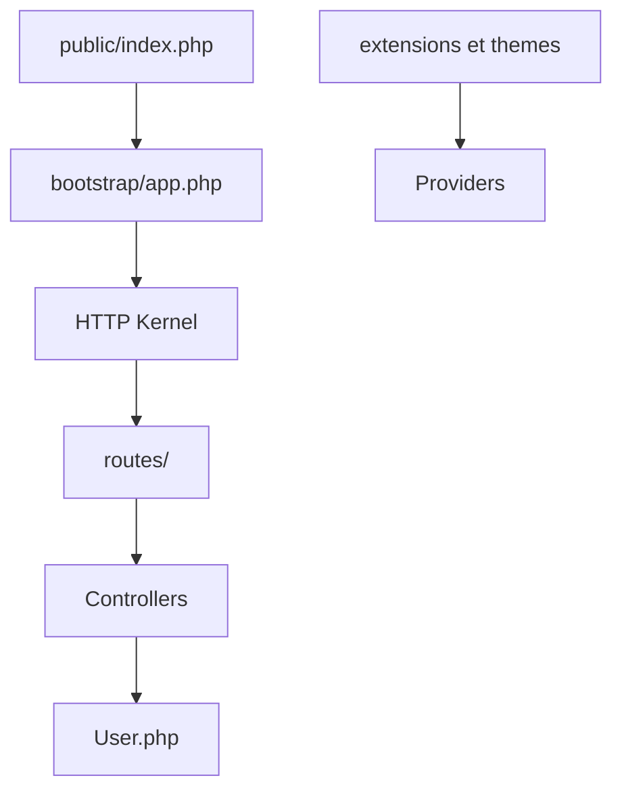

# tastyigniter/TastyIgniter

> Laravel platform for online ordering and table reservation for restaurants.

## The problem
A restaurant wants to take orders and reservations without paying a marketplace.

## What it actually does
A Laravel monolith serving the web interface and an API, with Sanctum for tokens, job queues, emails and real-time broadcasting. Restaurant-specific features come from the `extensions` and `themes` folders, which are not detailed in the analyzed tree.

## How it is wired


## Trying it
```bash
# Aucune commande dans ce README : renvoie à l'Installation Guide en ligne.
```

## Cost and gotchas
Free, MIT. You need PHP hosting with a database. The project is funded by Open Collective and Patreon; support via forum and Discord.

## What it is not
Not a managed service: you host and maintain it. The restaurant logic is not visible in the base repository.

## Alternatives
No alternative named in the README.

## For you
Ignore: a restaurant application unrelated to data, AI or MLOps work.
