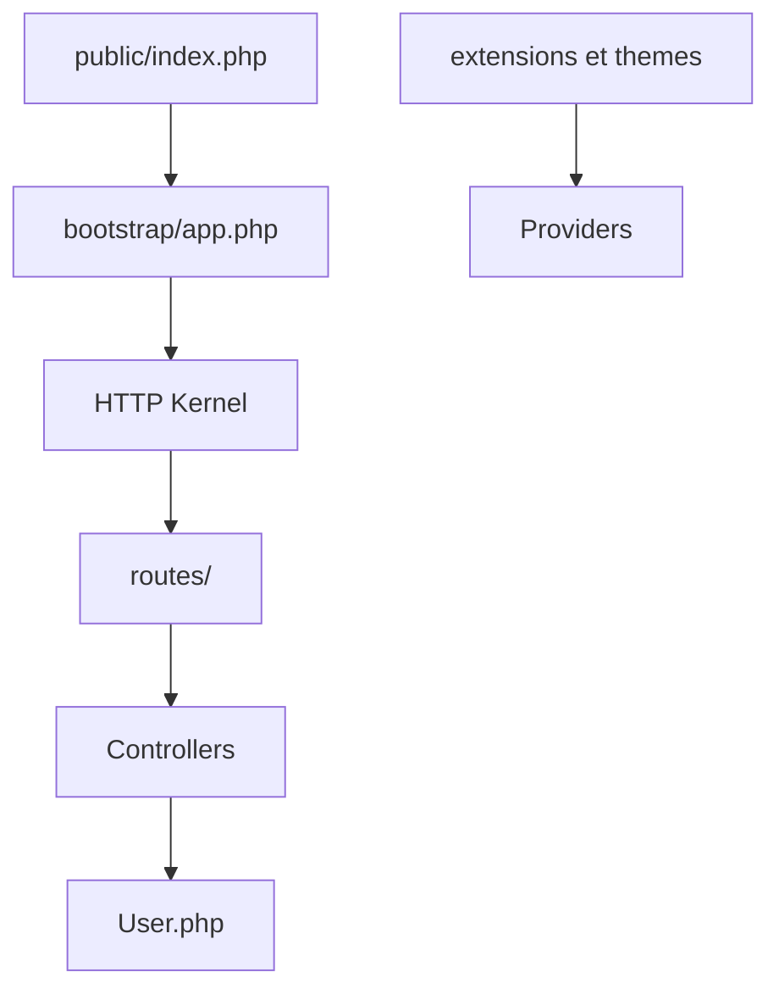

# tastyigniter/TastyIgniter

> Plateforme Laravel de commande en ligne et de réservation de tables pour restaurants.

## Le problème
Un restaurant veut prendre des commandes et des réservations sans payer une place de marché.

## Ce que ça fait vraiment
Monolithe Laravel qui sert l'interface web et une API, avec Sanctum pour les jetons, files de tâches, e-mails et diffusion en temps réel. Les fonctions propres aux restaurants viennent des dossiers `extensions` et `themes`, qui ne sont pas détaillés dans l'arbre analysé.

## Comment c'est branché


## Essayer
```bash
# Aucune commande dans ce README : renvoie à l'Installation Guide en ligne.
```

## Coût et pièges
Gratuit, MIT. Il faut un hébergement PHP avec base de données. Le projet est financé par Open Collective et Patreon ; support via forum et Discord.

## Ce que ce n'est pas
Pas un service géré : tu héberges et maintiens. La logique restaurant n'est pas visible dans le dépôt de base.

## Alternatives
Aucune alternative nommée dans le README.

## Pour toi
À ignorer : application de restauration sans lien avec un travail data, IA ou MLOps.

