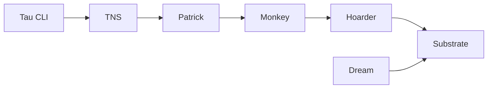

# taubyte/tau

> Peer-to-peer cloud platform in Go for deploying WebAssembly functions, websites and databases, for developers.

## The problem
Hosting functions, sites, storage and messaging requires assembling several cloud services. Tau offers a single, self-hostable platform.

## What it actually does
According to the architecture described from the code: a Go node composes services (Auth, TNS, Patrick, Monkey, Hoarder, Seer, Substrate). The `tau` CLI edits Git configuration repositories; builds produce WebAssembly or web resources, replicated then served by Substrate. Dream launches a local multi-node environment; Spore Drive deploys to servers. The README itself is very short: the rest is not documented here.

## How it is wired


## Trying it
```bash
# Aucune commande dans le README ; il renvoie à la documentation :
# https://tau.how/getting-started/local-cloud   (environnement local avec dream)
# https://tau.how/platform/deployment           (déploiement manuel)
# https://tau.how/platform/spore-drive          (déploiement automatisé)
```

## Cost and gotchas
Free; the servers or VMs of a real deployment are at your expense. Builds go through Docker or containerd according to the code. Account to create: not documented.

## What it is not
Not an AI or data tool: it is an application platform. The README (under 800 characters) does not allow judging how easy it is to get started; everything goes through an external site.

## Alternatives
Not documented: the README cites no alternative repository.

## For you
Worth watching: limited interest for a data/AI/MLOps profile as long as you do not need a self-hosted cloud; README too thin to decide further.
