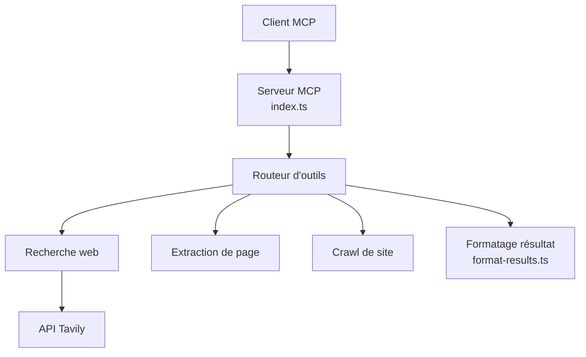

# tavily-ai/tavily-mcp

> Tavily's MCP server that gives an agent web search, extraction, mapping and site crawling.

## The problem
An AI agent needs structured web tools (search, page extraction, site mapping) rather than plain raw HTTP access.

## What it actually does
Exposes the `tavily-search`, `tavily-extract`, site mapping and systematic crawl tools. Each call is forwarded to the Tavily API and then formatted for the MCP client. Available as a remote server (with the key in the URL or OAuth) or locally via npx.

## How it is wired


## Trying it
```bash
npx -y tavily-mcp@latest
```

## Cost and gotchas
Requires a Tavily API key, at the user's expense. The optional `TAVILY_HUMAN_ID` identifier is hashed server-side (SHA-256) before storage.

## What it is not
Not an unlimited autonomous crawler: every operation consumes the Tavily API quota. Does not include result storage beyond the response returned to the client.

## Alternatives
No alternative named in the README.

## For you
Adopt it to equip a data/AI agent with reliable web search and extraction, accepting the cost of the Tavily API key.
