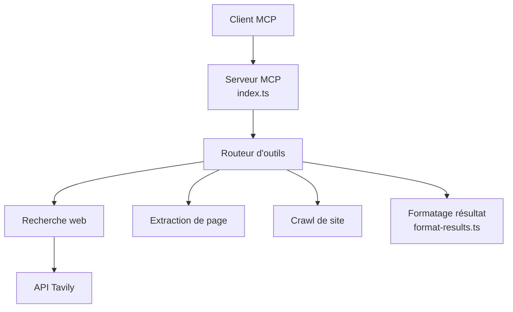

# tavily-ai/tavily-mcp

> Serveur MCP de Tavily qui donne à un agent la recherche, l'extraction, le mapping et le crawl de sites web.

## Le problème
Un agent IA a besoin d'outils web structurés (recherche, extraction de pages, cartographie de site) plutôt que d'un simple accès HTTP brut.

## Ce que ça fait vraiment
Expose les outils `tavily-search`, `tavily-extract`, de mapping de site et de crawl systématique. Chaque appel est transmis à l'API Tavily puis formaté pour le client MCP. Disponible en serveur distant (avec clé dans l'URL ou OAuth) ou local via npx.

## Comment c'est branché


## Essayer
```bash
npx -y tavily-mcp@latest
```

## Coût et pièges
Nécessite une clé d'API Tavily, à charge de l'utilisateur. L'identifiant `TAVILY_HUMAN_ID` optionnel est haché côté serveur (SHA-256) avant stockage.

## Ce que ce n'est pas
Pas un crawler autonome sans limites : chaque opération consomme le quota de l'API Tavily. N'inclut pas de stockage de résultats au-delà de la réponse renvoyée au client.

## Alternatives
Aucune alternative nommée dans le README.

## Pour toi
À adopter pour équiper un agent data/IA de recherche et d'extraction web fiables, en acceptant le coût de la clé d'API Tavily.

