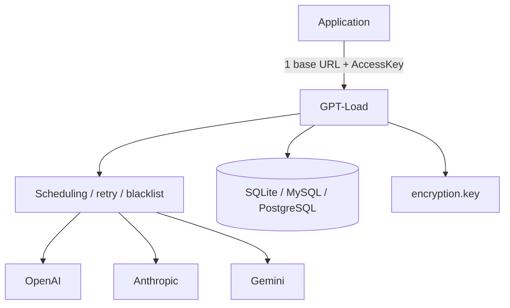

# tbphp/gpt-load

> Self-hosted AI gateway to manage several channels and credentials behind a single entry point.

## The problem
Multiplying providers, accounts and LLM API keys forces every application to handle routing, quotas, outages and accounting. There is no unified view.

## What it actually does
A single base URL and one AccessKey for the application; providers, accounts, models and routing are configured in the UI. Native protocols: OpenAI, Anthropic Messages, Gemini, plus Responses, Images, Embeddings, Rerank. Multi-credential scheduling, weights, retries, cooldown, blacklist, session affinity. Subscription channels (Codex, Claude, Antigravity, Grok) via OAuth. Observability UI, SQLite/MySQL/PostgreSQL, locally encrypted credentials.

## How it is wired


## Trying it
```bash
git clone --depth 1 https://github.com/tbphp/gpt-load.git
cd gpt-load
cp .env.example .env
docker compose up -d
```

## Cost and gotchas
Free to self-host, but the providers' API keys are at your expense. `encryption.key` must be backed up along with the database (no rotation). Listens on loopback by default. Designed for a single instance (no horizontal scaling). 2.0 does not migrate 1.x data.

## What it is not
Not a universal any-protocol translator. Costs and usage are **estimates**, not a provider invoice.

## Alternatives
- one-api / new-api: competing gateways mentioned for context.

## For you
Handy if you juggle several LLM accounts/keys and want a single observable entry point; beware the single maintainer.
