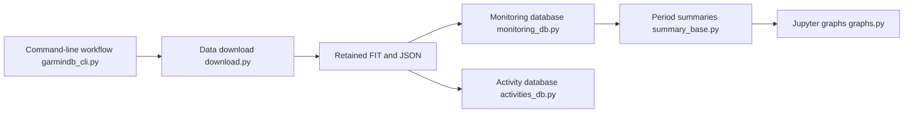

# tcgoetz/GarminDB

> Python scripts that download your Garmin Connect health data and store it in SQLite.

## The problem
Garmin data stays inside Garmin Connect, hard to query and analyze outside the app.

## What it actually does
Downloads and imports daily monitoring files (heart rate, activity, stress), sleep, weight, activities (laps, records), keeps the FIT and JSON files so the database can be rebuilt, produces daily, weekly, monthly and yearly summaries, graphs and TCX exports. Jupyter notebooks included, plugins for Connect IQ apps, Fitbit and Microsoft Health import.

## How it is wired


## Trying it
```bash
pip install garmindb
garmindb_cli.py --all --download --import --analyze
garmindb_cli.py --all --download --import --analyze --latest
garmindb_cli.py --backup
```

## Cost and gotchas
You have to copy `GarminConnectConfig.json.example` to `~/.GarminDb/` with your Garmin Connect username and password in clear text. A schema change requires `--rebuild_db`. Developed on macOS.

## What it is not
Not an official Garmin service: it relies on Connect, whose access can break. GPL-2.0 license (copyleft).

## Alternatives
No alternative named in the README (SQLite Studio, HeidiSQL, DB Browser cited for browsing the database).

## For you
Adopt for a personal data project: a personal dataset usable in pandas/Jupyter, an old (2017) and active project.
