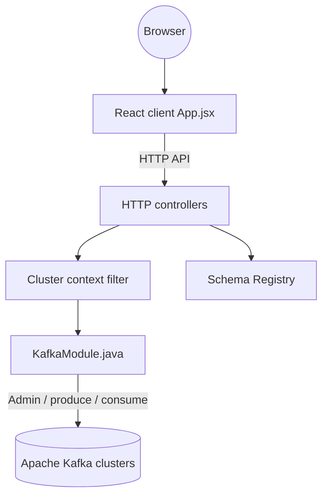

# tchiotludo/akhq

> GUI for Apache Kafka: topics, consumer groups, schema registry and connect, for data teams.

## The problem
Inspecting Kafka topics, messages and consumer groups from the command line is slow and hard to read.

## What it actually does
A Java Micronaut application with a React client that manages topics and records (read and produce), consumer groups, ACLs, brokers, Kafka Connect, Schema Registry (Avro, JSON Schema, Protobuf) and ksqlDB. Handles multiple clusters, authentication (basic, LDAP, OIDC, GitHub), data masking and an audit log. Deploys with Docker or via Helm on Kubernetes.

## How it is wired

## Trying it
The README gives no command: it points to the official documentation at akhq.io. Configuration goes through `application.yml`; a Docker image and a Helm chart exist according to the architecture.

## Cost and gotchas
Free. Requires an accessible Kafka cluster and configuring security and permissions. Plan to restrict access: the tool allows writing to topics.

## What it is not
Not a streaming client nor an orchestrator: it is an administration console. It is not affiliated with Apache. The Kestra block in the README is a promotion of another project by the author.

## Alternatives
No alternative named in the README.

## For you
Adopt if you run Kafka in a data pipeline: a proven tool, used by many companies, that saves you from scripting topic inspection.
