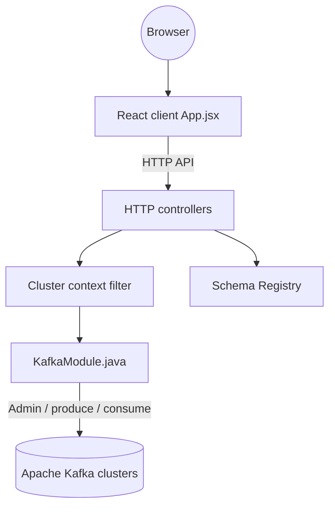

# tchiotludo/akhq

> Interface graphique pour Apache Kafka : topics, groupes de consommateurs, schema registry et connect, pour équipes data.

## Le problème
Inspecter des topics Kafka, des messages et des groupes de consommateurs en ligne de commande est lent et peu lisible.

## Ce que ça fait vraiment
Application Java Micronaut avec client React qui administre topics et enregistrements (lecture et production), groupes de consommateurs, ACL, brokers, Kafka Connect, Schema Registry (Avro, JSON Schema, Protobuf) et ksqlDB. Gère plusieurs clusters, l'authentification (basic, LDAP, OIDC, GitHub), le masquage de données et un journal d'audit. Se déploie en Docker ou via Helm sur Kubernetes.

## Comment c'est branché

## Essayer
Le README ne donne pas de commande : il renvoie à la documentation officielle sur akhq.io. La configuration passe par `application.yml` ; une image Docker et un chart Helm existent d'après l'architecture.

## Coût et pièges
Gratuit. Demande un cluster Kafka accessible et la configuration de la sécurité et des droits. Prévoir de limiter l'accès : l'outil permet d'écrire dans les topics.

## Ce que ce n'est pas
Pas un client de streaming ni un orchestrateur : c'est une console d'administration. Il n'est pas affilié à Apache. Le bloc Kestra du README est une promotion d'un autre projet de l'auteur.

## Alternatives
Aucune alternative nommée dans le README.

## Pour toi
À adopter si tu exploites Kafka dans une chaîne de données : outil éprouvé, utilisé par de nombreuses entreprises, qui évite de scripter l'inspection des topics.

