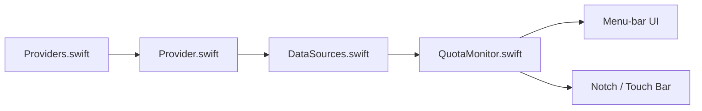

# tddworks/ClaudeBar

> macOS menu-bar application that tracks AI coding assistant quotas in real time.

## The problem
Quotas (5-hour session, weekly) for Claude, Codex, Gemini, Copilot and others are scattered, and you discover them exhausted.

## What it actually does
Queries each enabled provider (CLI, API or local database) and shows colored gauges with countdowns, threshold alerts and consumption-pace alerts. Account switching, themes, Touch Bar widget, notch display, script-based extensions in `~/.claudebar/extensions/`, optional publishing to iPhone via Notify!.

## How it is wired


## Trying it
```bash
brew install --cask claudebar
git clone https://github.com/tddworks/ClaudeBar.git
cd ClaudeBar
brew install tuist
tuist install
tuist build ClaudeBar -C Release
```

## Cost and gotchas
macOS 15+ and Swift 6.2+ to build. Some modes read browser cookies (Full Disk Access) or local tokens. Notify! sends provider names and percentages to a third-party service.

## What it is not
Not a billing or cost-optimization tool: it reads quotas. No license declared: reuse rights not established.

## Alternatives
No alternative named in the README.

## For you
Worth watching: handy if you juggle several coding-assistant subscriptions, but the lack of a license blocks any serious reuse.
