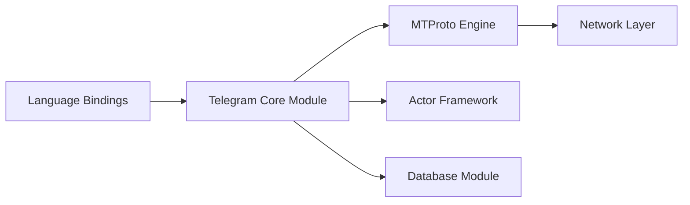

# tdlib/td

> Cross-platform C++ library for building Telegram clients, usable from almost any language.

## The problem
Writing a Telegram client means handling networking, encryption, local storage and update ordering.

## What it actually does
TDLib handles the protocol, encryption, encrypted local database and ordered updates, asynchronously. Interfaces: JSON (C, hence nearly universal), C++, Java (JNI) and .NET. According to the README, it powers more than 43,000 bots per instance in Telegram's Bot API.

## How it is wired


## Trying it
```bash
mkdir build
cd build
cmake -DCMAKE_BUILD_TYPE=Release ..
cmake --build .
```

## Cost and gotchas
Free, BSL-1.0. Dependencies: C++17 compiler, OpenSSL, zlib, gperf, CMake 3.10+. Building requires a lot of RAM (`SplitSource.php` script for small machines).

## What it is not
Not the HTTP Bot API: it is the full client library. A Telegram account is still required.

## Alternatives
No alternative named in the README.

## For you
Ignore: unless you do large-scale Telegram collection or automation, nothing useful for data/AI.
