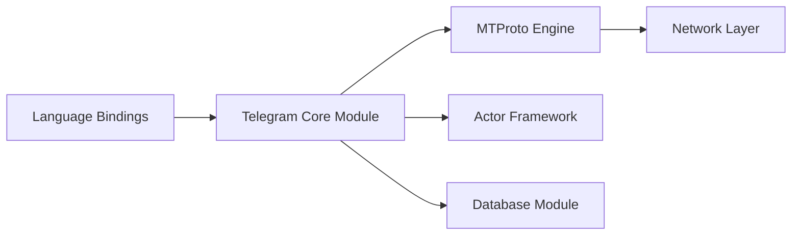

# tdlib/td

> Bibliothèque C++ multiplateforme pour construire des clients Telegram, utilisable depuis presque tout langage.

## Le problème
Écrire un client Telegram impose de gérer réseau, chiffrement, stockage local et ordre des mises à jour.

## Ce que ça fait vraiment
TDLib gère protocole, chiffrement, base locale chiffrée et mises à jour ordonnées, de façon asynchrone. Interfaces JSON (C, donc quasi universelle), C++, Java (JNI) et .NET. Elle sert, selon le README, plus de 43 000 bots par instance dans l'API Bot de Telegram.

## Comment c'est branché


## Essayer
```bash
mkdir build
cd build
cmake -DCMAKE_BUILD_TYPE=Release ..
cmake --build .
```

## Coût et pièges
Gratuit, BSL-1.0. Dépendances : compilateur C++17, OpenSSL, zlib, gperf, CMake 3.10+. La compilation exige beaucoup de RAM (script `SplitSource.php` pour les petites machines).

## Ce que ce n'est pas
Pas l'API Bot HTTP : c'est la bibliothèque cliente complète. Un compte Telegram reste nécessaire.

## Alternatives
Aucune alternative nommée dans le README.

## Pour toi
Ignorer : sauf collecte ou automatisation Telegram à grande échelle, rien d'utile pour data/IA.

