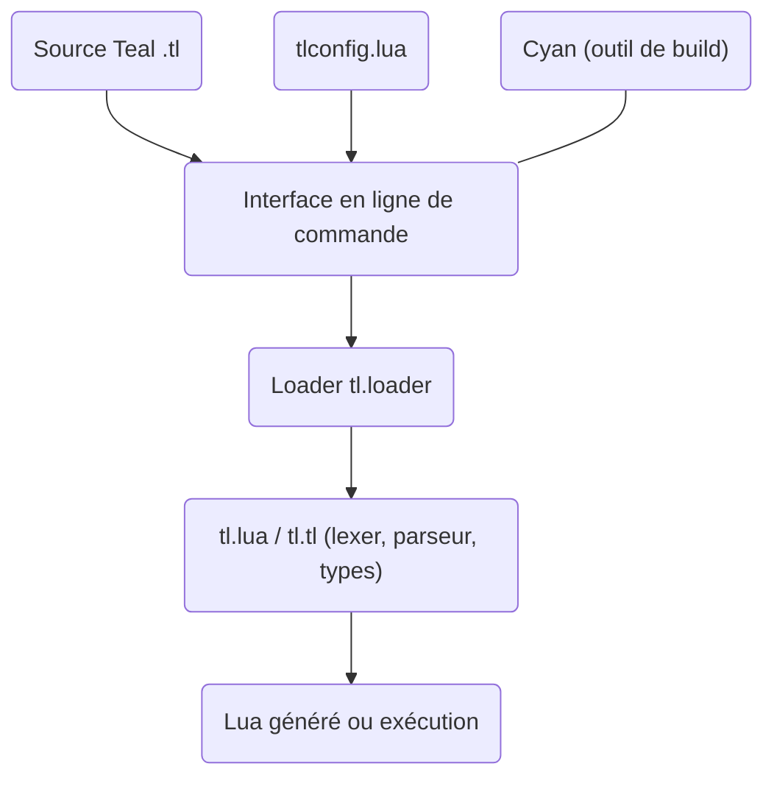

# teal-language/tl

> Compiler for Teal, a typed dialect of Lua, shipped as a single dependency-free tl.lua file.

## The problem
Lua has no types: errors in data shapes only appear at runtime.

## What it actually does
Type-checks Teal code, then generates plain Lua without annotations. The core fits in tl.lua, with a tl.tl version. The `tl.loader()` loader lets require() read .tl files on the fly. Subcommands run, check, gen and warnings; options on the command line or in tlconfig.lua. Works with Lua 5.1 to 5.4 and LuaJIT.

## How it is wired


## Trying it
```bash
luarocks install tl
tl run script.tl
tl check module.tl
tl gen module.tl
tl warnings
```

## Cost and gotchas
Free. To install through LuaRocks, you need Lua and LuaRocks; standalone Linux and Windows x86_64 binaries exist. Declaration files (teal-types) type third-party Lua libraries.

## What it is not
Not an independent language: it compiles to Lua. Not a project build tool: the README recommends Cyan for that.

## Alternatives
No alternative cited; Cyan is the associated build tool.

## For you
Ignore: only useful if you write Lua, which is not the case in a data / AI workflow.
