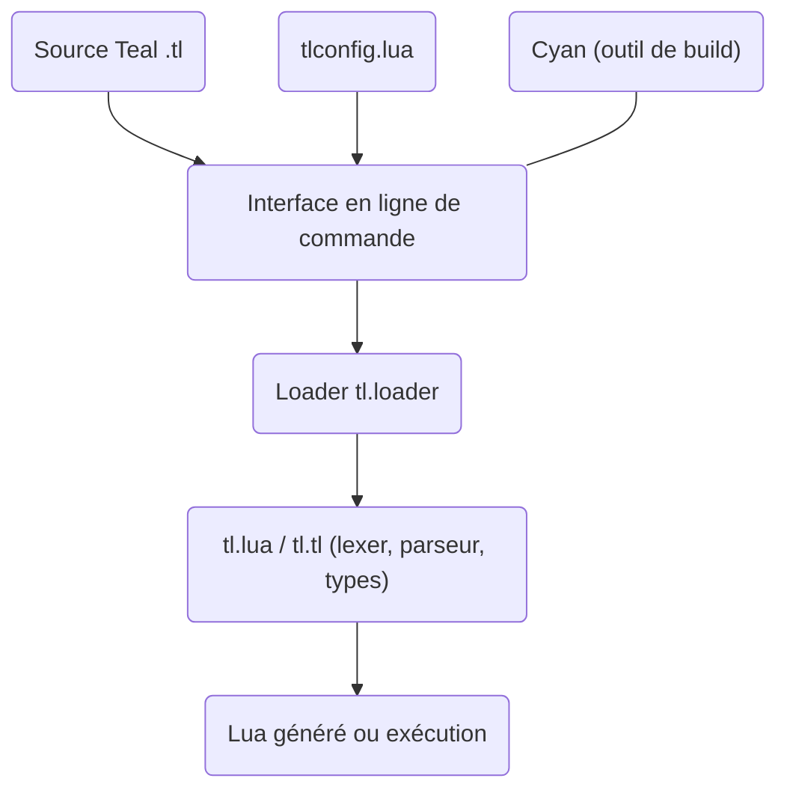

# teal-language/tl

> Compilateur de Teal, un dialecte typé de Lua, livré en un seul fichier tl.lua sans dépendance.

## Le problème
Lua n'a pas de types : les erreurs sur les formes de données n'apparaissent qu'à l'exécution.

## Ce que ça fait vraiment
Vérifie les types d'un code Teal puis génère du Lua pur sans annotations. Le cœur tient dans tl.lua, avec une version tl.tl. Le chargeur `tl.loader()` permet à require() de lire des fichiers .tl à la volée. Sous-commandes run, check, gen et warnings ; options en ligne de commande ou dans tlconfig.lua. Fonctionne avec Lua 5.1 à 5.4 et LuaJIT.

## Comment c'est branché


## Essayer
```bash
luarocks install tl
tl run script.tl
tl check module.tl
tl gen module.tl
tl warnings
```

## Coût et pièges
Gratuit. Pour installer par LuaRocks, il faut Lua et LuaRocks ; des binaires Linux et Windows x86_64 autonomes existent. Des fichiers de déclaration (teal-types) typent les bibliothèques Lua tierces.

## Ce que ce n'est pas
Pas un langage indépendant : il compile vers Lua. Pas un outil de build de projet : le README recommande Cyan pour cela.

## Alternatives
Aucune alternative citée ; Cyan est l'outil de build associé.

## Pour toi
Ignorer : utile seulement si tu écris en Lua, ce qui n'est pas le cas dans un flux data / IA.

