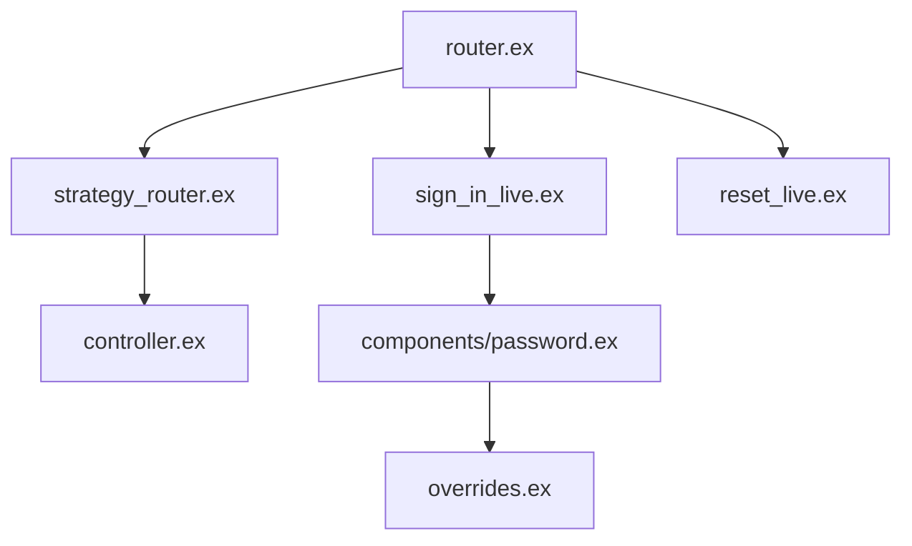

# team-alembic/ash_authentication_phoenix

> Phoenix extension for Ash Authentication: routes, LiveView pages and sign-in UI components.

## The problem
Plugging Ash authentication into a Phoenix application requires writing pages and routes yourself.

## What it actually does
A router declares the authentication routes and delegates to controllers and LiveView pages (sign-in, reset). Components, such as the password form, are customized through overrides.

## How it is wired


## Trying it
```bash
# Aucune commande dans le README : renvoie vers le tutoriel Get Started
```

## Cost and gotchas
Free, but reserved for Elixir, Phoenix and Ash. The catalog sees no license, whereas an SPDX header in the README indicates MIT.

## What it is not
Not a standalone authentication solution: a UI layer for Ash Authentication.

## Alternatives
- Ash Authentication: the base package cited in the README.

## For you
Ignore: only useful for a Phoenix and Ash application.
