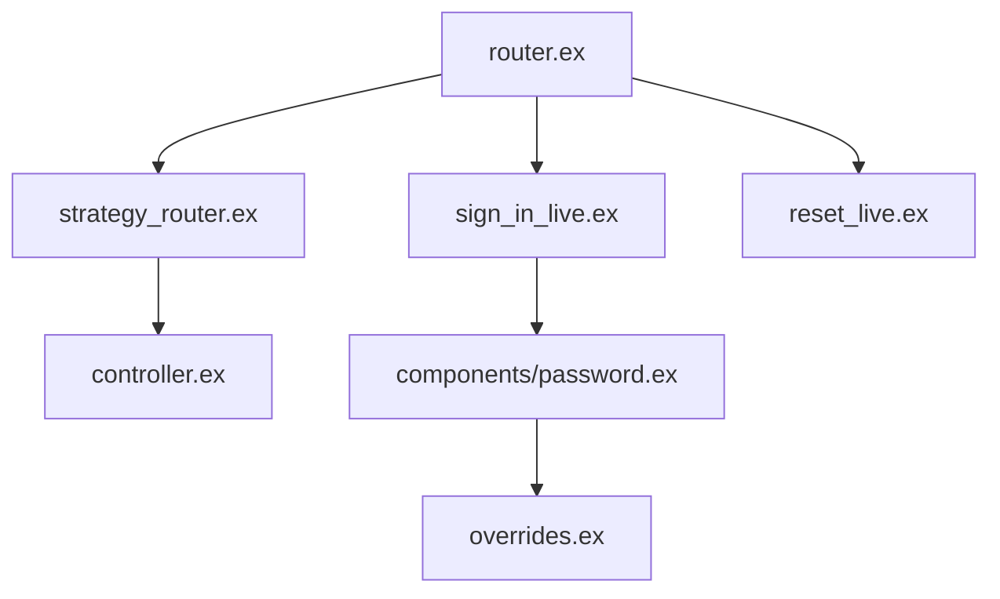

# team-alembic/ash_authentication_phoenix

> Extension Phoenix pour Ash Authentication : routes, pages LiveView et composants d'interface de connexion.

## Le problème
Brancher l'authentification Ash dans une application Phoenix demande des pages et des routes à écrire soi-même.

## Ce que ça fait vraiment
Un routeur déclare les routes d'authentification et délègue aux contrôleurs et pages LiveView (connexion, réinitialisation). Les composants, comme le formulaire de mot de passe, se personnalisent par overrides.

## Comment c'est branché


## Essayer
```bash
# Aucune commande dans le README : renvoie vers le tutoriel Get Started
```

## Coût et pièges
Gratuit, mais réservé à Elixir, Phoenix et Ash. Le catalogue ne voit pas de licence, alors qu'un en-tête SPDX du README indique MIT.

## Ce que ce n'est pas
Pas une solution d'authentification autonome : une couche d'interface pour Ash Authentication.

## Alternatives
- Ash Authentication : le paquet de base cité dans le README.

## Pour toi
Ignorer : utile seulement pour une application Phoenix et Ash.

