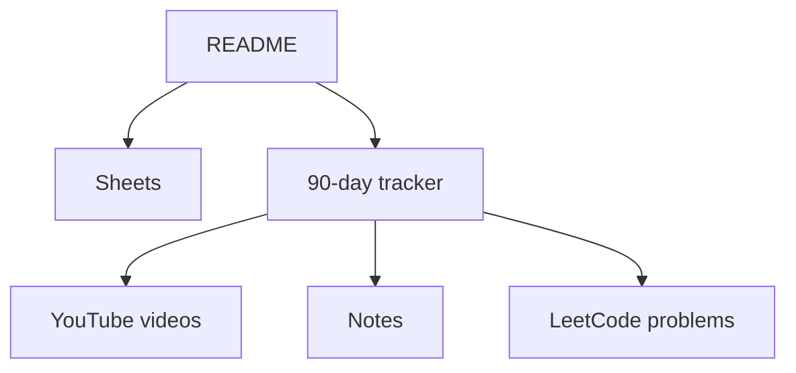

# team-codebug/babua-dsa-patterns-course

> A 90-day video course on 30 algorithm patterns, to prepare for coding interviews.

## The problem
Solving hundreds of random exercises for technical interviews is inefficient; a pattern-based thread is missing.

## What it actually does
A README that works as a dashboard: sheets (onboarding, patterns, revision), a day-by-day tracking table with YouTube videos and notes, and a LinkedIn post template. Each pattern: a theory video, 15 to 20 LeetCode questions, notes. Course in Java (Python optional) with explanations in Hindi. The table only details days 0 to 11; the rest is announced.

## How it is wired

Diagram taken from the README, no architecture from the code provided.

## Trying it
No command in the README; it asks you to fork the repository and tick off each day.

## Cost and gotchas
Free. The content is mostly YouTube video (outside the repository); duration 90 days, daily session announced at 5 pm IST.

## What it is not
Not a code or solutions repository: essentially links. No license, so the content is not reusable as is. The promise "covers 95% of problems" is unverified marketing.

## Alternatives
None cited in the README.

## For you
Ignore: algorithmic interview preparation, with no benefit for a data/AI/MLOps profile.
