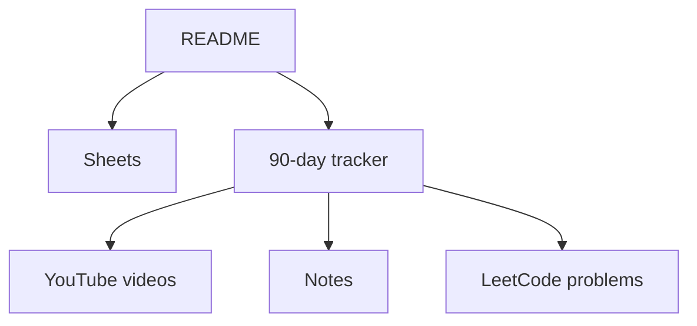

# team-codebug/babua-dsa-patterns-course

> Parcours de 90 jours en vidéo sur 30 patrons d'algorithmes, pour préparer les entretiens de code.

## Le problème
Résoudre des centaines d'exercices au hasard pour les entretiens techniques est inefficace ; il manque un fil conducteur par patrons.

## Ce que ça fait vraiment
Un README qui sert de tableau de bord : feuilles (onboarding, patrons, révision), tableau de suivi jour par jour avec vidéos YouTube et notes, modèle de post LinkedIn. Chaque patron : vidéo de théorie, 15 à 20 questions LeetCode, notes. Cours en Java (Python optionnel) avec explications en hindi. Le tableau ne détaille que les jours 0 à 11 ; la suite est annoncée.

## Comment c'est branché

Schéma tiré du README, aucune architecture d'après le code fournie.

## Essayer
Aucune commande dans le README ; il demande de forker le dépôt et de cocher chaque jour.

## Coût et pièges
Gratuit. Le contenu est surtout en vidéo YouTube (hors dépôt) ; durée 90 jours, séance quotidienne annoncée à 17h IST.

## Ce que ce n'est pas
Pas un dépôt de code ni de solutions : essentiellement des liens. Aucune licence, donc contenu non réutilisable en l'état. La promesse « couvre 95 % des problèmes » est du marketing non vérifié.

## Alternatives
Aucune citée dans le README.

## Pour toi
Ignorer : préparation d'entretiens algorithmiques, sans apport pour un profil data/IA/MLOps.

