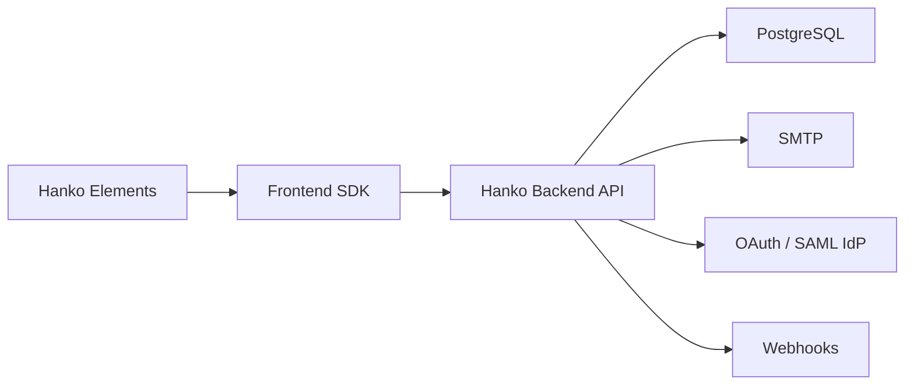

# teamhanko/hanko

> Open source authentication and user management solution, centered on passkeys, for web application developers.

## The problem
Building secure authentication (passwords, MFA, passkeys, SSO) yourself is slow and error-prone.

## What it actually does
A Go backend exposes an API for passwords, email codes, passkeys, OAuth, SAML, MFA (TOTP, security keys), sessions and webhooks, issuing JWTs. Web components (Hanko Elements) and a front-end SDK (TypeScript) provide the interface. PostgreSQL stores the data; Redis is optional. Available self-hosted or as a managed service (Hanko Cloud).

## How it is wired

## Trying it
The README provides no command: it points to the quickstart application and the `quickstart.yaml` file (Docker), without a detailed command. No command reproduced.

## Cost and gotchas
The code is free, but the managed service is paid. You need PostgreSQL and an SMTP server. A license is present but not identified by GitHub, and the SAML part is described as an enterprise edition.

## What it is not
Not a simple encryption module: it is a service to deploy. Organizations, roles and permissions are still in progress.

## Alternatives
No alternative named in the README.

## For you
Worth watching: interesting for adding passkeys to an application or an AI dashboard, after checking the license; pocket-id is enough if you only want SSO.
