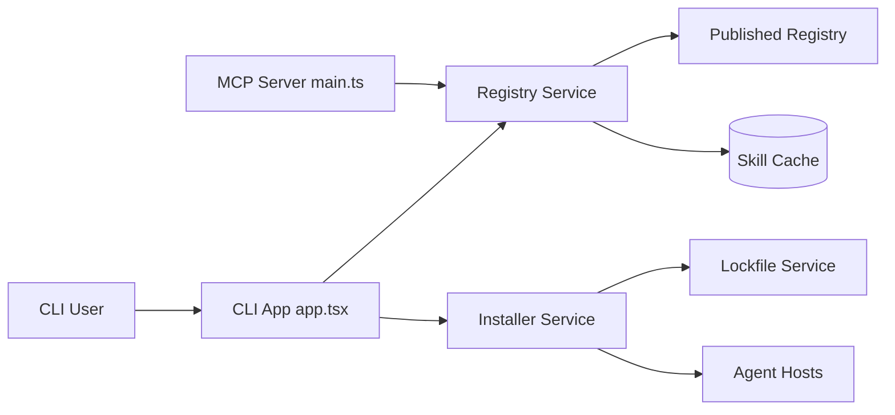

# tech-leads-club/agent-skills

> A skills registry for coding agents (Claude Code, Cursor…), installable via CLI or MCP server.

## The problem
Agent skills found on open marketplaces are of uneven quality, and the README cites 13.4% of them as having critical flaws. Copying them by hand into each agent is tedious.

## What it actually does
A CLI downloads a catalog of skills on demand from a CDN, caches them in `~/.cache/agent-skills/` and installs them (copy or symlink) into the chosen agent's configuration, globally or locally. A lock file and an audit log trace the operations. An MCP server exposes skill search and reading, and a web marketplace lets you browse them.

## How it is wired


## Trying it
```bash
npx @tech-leads-club/agent-skills
agent-skills list
agent-skills install -s tlc-spec-driven
agent-skills install -s my-skill -a cursor claude-code
agent-skills audit
```

## Cost and gotchas
Free, requires Node. The license is present but not identified by GitHub: read it before reusing. The content of the skills remains text that drives your agent: review it.

## What it is not
It is not an absolute security guarantee: the README claims scans and human curation, not an independent audit. The README also states that the content is a collection from various authors, removable on request.

## Alternatives
No alternative is named in the README.

## For you
Worth watching: handy for gathering skills (spec-driven, AWS, Playwright) in a single tool, but the license is unclear and skills must be reviewed before entrusting them to an agent.
