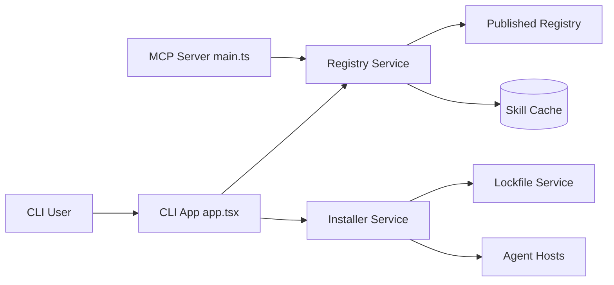

# tech-leads-club/agent-skills

> Un registre de skills pour agents de code (Claude Code, Cursor…), installable par CLI ou serveur MCP.

## Le problème
Les skills d'agents trouvés sur des places de marché ouvertes sont de qualité inégale, et le README cite 13,4 % d'entre eux avec des failles critiques. Les copier à la main dans chaque agent est fastidieux.

## Ce que ça fait vraiment
Une CLI télécharge à la demande un catalogue de skills depuis un CDN, les met en cache dans `~/.cache/agent-skills/` et les installe (copie ou lien symbolique) dans la configuration de l'agent choisi, en global ou en local. Un fichier de verrouillage et un journal d'audit tracent les opérations. Un serveur MCP expose la recherche et la lecture des skills, et une place de marché web permet de les parcourir.

## Comment c'est branché


## Essayer
```bash
npx @tech-leads-club/agent-skills
agent-skills list
agent-skills install -s tlc-spec-driven
agent-skills install -s my-skill -a cursor claude-code
agent-skills audit
```

## Coût et pièges
Gratuit, nécessite Node. La licence est présente mais non identifiée par GitHub : à lire avant de réutiliser. Le contenu des skills reste du texte qui pilote ton agent : relis-le.

## Ce que ce n'est pas
Ce n'est pas une garantie de sécurité absolue : le README revendique des scans et une curation humaine, pas un audit indépendant. Le README précise aussi que le contenu est une collection d'auteurs variés, retirable sur demande.

## Alternatives
Aucune alternative nommée dans le README.

## Pour toi
À surveiller : pratique pour récupérer des skills (spec-driven, AWS, Playwright) en un seul outil, mais licence floue et skills à relire avant de les confier à un agent.

