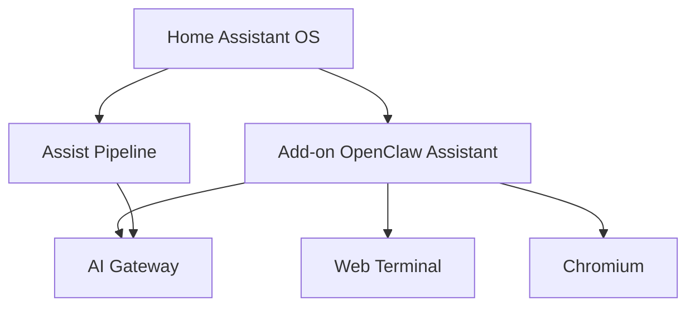

# techartdev/OpenClawHomeAssistant

> Home Assistant add-on that runs OpenClaw inside HAOS, with a web terminal and a conversation agent.

## The problem
Using the OpenClaw agent with a Home Assistant OS installation, without maintaining it separately or losing its configuration.

## What it actually does
- OpenClaw server with chat, skills and automation, inside an add-on.
- Built-in web terminal and Chromium for browser automation.
- Usable as an Assist conversation agent through an OpenAI-compatible API.
- Persistent storage; git, ripgrep, jq, pnpm and Homebrew tools included.

## How it is wired

Simplified diagram based on the sheet; no diagram was provided.

## Trying it
No command: installation through the interface. Settings, Add-ons, Store, Repositories, add `https://github.com/techartdev/OpenClawHomeAssistant`, then install "OpenClaw Assistant".

## Cost and gotchas
Free, but the agent needs a model provider, not detailed in the README. A security warning points to a document to read before use: browser and terminal are exposed.

## What it is not
Not OpenClaw itself, nor the Home Assistant integration, which is another repository. HAOS only.

## Alternatives
The OpenClawHomeAssistantIntegration integration, cited at the top of the README, for use on the Home Assistant side.

## For you
Worth watching: handy if you run OpenClaw at home under Home Assistant; otherwise of no interest, with security risks to read about first.
