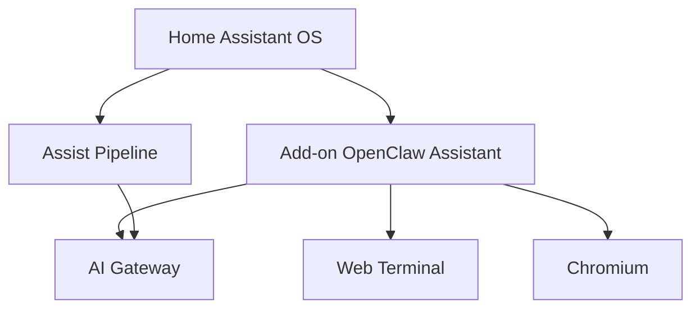

# techartdev/OpenClawHomeAssistant

> Add-on Home Assistant qui fait tourner OpenClaw dans HAOS, avec terminal web et agent de conversation.

## Le problème
Utiliser l'agent OpenClaw avec une installation Home Assistant OS, sans le maintenir à part ni perdre sa configuration.

## Ce que ça fait vraiment
- Serveur OpenClaw avec chat, skills et automatisation, dans un add-on.
- Terminal web intégré et Chromium pour l'automatisation de navigateur.
- Utilisable comme agent de conversation Assist via une API compatible OpenAI.
- Stockage persistant ; outils git, ripgrep, jq, pnpm et Homebrew inclus.

## Comment c'est branché

Schéma simplifié d'après la fiche, sans diagramme fourni.

## Essayer
Aucune commande : installation par l'interface. Paramètres, Add-ons, Boutique, Dépôts, ajouter `https://github.com/techartdev/OpenClawHomeAssistant`, puis installer « OpenClaw Assistant ».

## Coût et pièges
Gratuit, mais l'agent a besoin d'un fournisseur de modèle, non détaillé dans le README. Un avertissement de sécurité renvoie à un document à lire avant usage : navigateur et terminal exposés.

## Ce que ce n'est pas
Pas OpenClaw lui-même, ni l'intégration Home Assistant, qui est un autre dépôt. Réservé à HAOS.

## Alternatives
L'intégration OpenClawHomeAssistantIntegration, citée en tête du README, pour un usage côté Home Assistant.

## Pour toi
À surveiller : pratique si tu fais tourner OpenClaw chez toi sous Home Assistant ; sinon sans intérêt, avec des risques de sécurité à lire d'abord.

