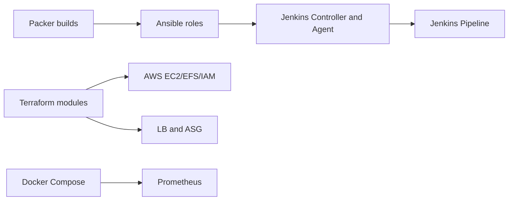

# techiescamp/devops-projects

> Collection of hands-on DevOps projects on AWS for beginners, with Terraform, Ansible and Packer scripts.

## The problem
Learning DevOps without concrete projects on a real cloud leaves a gap between tutorials and real practice.

## What it actually does
Ten listed projects: highly available Jenkins, Consul service discovery, a scalable Java app, a Prometheus stack in Docker Compose, a Terraform VPC, client-site VPN, Pritunl, Fargate, GitHub Actions–AWS OIDC, a Route53 private zone. According to the code, each folder separates Packer (images), Ansible (roles) and Terraform (EC2, EFS, IAM, LB-ASG, RDS modules). The README also does promotion (Kubernetes certification vouchers, cloud credits).

## How it is wired

## Trying it
No command in the README: each project has its own instructions (not provided here).

## Cost and gotchas
The projects provision billed AWS resources: the README advises destroying them after use. Free cloud credits are listed. The README's promo codes are dated and advertising.

## What it is not
Not a structured course nor a tool to install. No license: reuse of the code is not permitted as it stands.

## Alternatives
None named in the README.

## For you
Watch: useful as a source of MLOps exercises (Terraform, Prometheus, CI) but to be read without the promotional wrapping; check the AWS costs.
