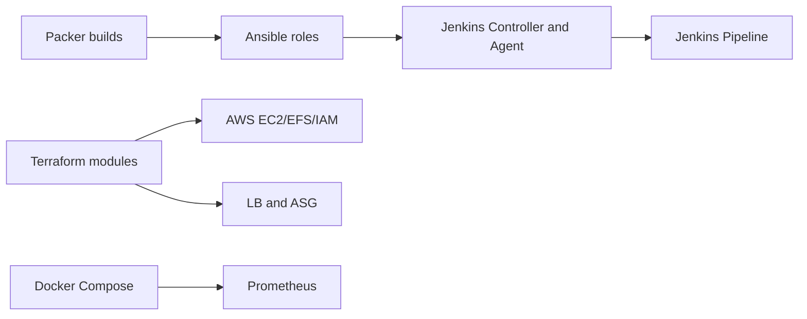

# techiescamp/devops-projects

> Collection de projets DevOps pratiques sur AWS pour débutants, avec scripts Terraform, Ansible et Packer.

## Le problème
Apprendre le DevOps sans projets concrets sur un vrai cloud laisse un écart entre tutoriels et pratique réelle.

## Ce que ça fait vraiment
Dix projets listés : Jenkins HA, service discovery Consul, appli Java scalable, stack Prometheus en Docker Compose, VPC Terraform, VPN client-site, Pritunl, Fargate, OIDC GitHub Actions–AWS, zone privée Route53. D'après le code, chaque dossier sépare Packer (images), Ansible (rôles) et Terraform (modules EC2, EFS, IAM, LB-ASG, RDS). Le README fait aussi de la promotion (bons de certification Kubernetes, crédits cloud).

## Comment c'est branché

## Essayer
Aucune commande dans le README : chaque projet a ses propres instructions (non fournies ici).

## Coût et pièges
Les projets provisionnent des ressources AWS facturées : le README conseille de les détruire après usage. Des crédits cloud gratuits sont listés. Les codes promotionnels du README sont datés et publicitaires.

## Ce que ce n'est pas
Pas une formation structurée ni un outil à installer. Licence absente : réutilisation du code non autorisée en l'état.

## Alternatives
Aucune nommée dans le README.

## Pour toi
Surveiller : utile comme source d'exercices MLOps (Terraform, Prometheus, CI) mais à lire sans l'enrobage promotionnel ; vérifie les coûts AWS.

