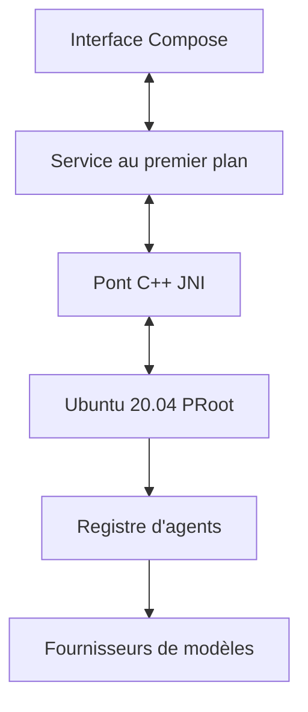

# techjarves/Mobile-Harness

> Android app that embeds an Ubuntu in PRoot to drive Claude Code and other agents from a phone.

## The problem
Using a coding agent or a Linux terminal on a phone requires Termux, ADB and a lot of tinkering.

## What it actually does
Jetpack Compose interface, C++ JNI bridge and a rootless Ubuntu 20.04 subsystem. The Claude Code, DeepSeek Harness and Antigravity CLI agents run there, with persistent projects, web preview and on-device Android builds. API keys are stored in the Android Keystore.

## How it is wired
Diagram based on the README's diagram.


## Trying it
```bash
git clone https://github.com/techjarves/Mobile-Harness.git
cd Mobile-Harness
./gradlew assembleDebug
adb install -r app/build/outputs/apk/debug/app-debug.apk
```

## Cost and gotchas
Android 9+ on ARM64 only, 4 GB of RAM minimum and 2.5 GB of storage. Anthropic or compatible API key at your expense. Antigravity is launched with `--dangerously-skip-permissions`. Building requires JDK 17, Android Studio and the NDK.

## What it is not
Not a secure virtual machine: PRoot does not isolate against hostile code. Docker, KVM and systemd are not supported.

## Alternatives
Not documented in the README.

## For you
Worth watching: curious for running an agent on the go, but the weak isolation and the permission-less mode advise against entrusting it with sensitive code or keys.
