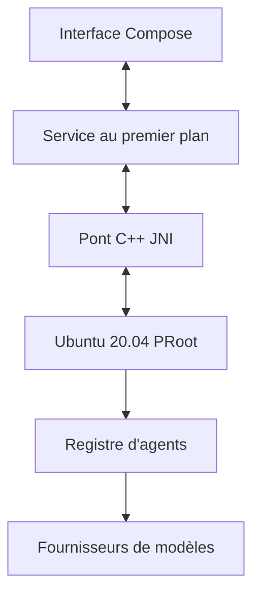

# techjarves/Mobile-Harness

> Application Android qui embarque un Ubuntu en PRoot pour piloter Claude Code et d'autres agents depuis un téléphone.

## Le problème
Utiliser un agent de code ou un terminal Linux sur téléphone demande Termux, ADB et beaucoup de bricolage.

## Ce que ça fait vraiment
Interface Jetpack Compose, pont C++ JNI et sous-système Ubuntu 20.04 sans root. Les agents Claude Code, DeepSeek Harness et Antigravity CLI y tournent, avec projets persistants, aperçu web et compilation Android sur l'appareil. Les clés d'API sont stockées dans l'Android Keystore.

## Comment c'est branché
Schéma d'après le diagramme du README.


## Essayer
```bash
git clone https://github.com/techjarves/Mobile-Harness.git
cd Mobile-Harness
./gradlew assembleDebug
adb install -r app/build/outputs/apk/debug/app-debug.apk
```

## Coût et pièges
Android 9+ en ARM64 uniquement, 4 Go de RAM minimum et 2,5 Go de stockage. Clé d'API Anthropic ou compatible à ta charge. Antigravity est lancé avec `--dangerously-skip-permissions`. Compiler demande JDK 17, Android Studio et NDK.

## Ce que ce n'est pas
Ce n'est pas une machine virtuelle sécurisée : PRoot n'isole pas du code hostile. Docker, KVM et systemd ne sont pas pris en charge.

## Alternatives
Non documenté dans le README.

## Pour toi
À surveiller : curieux pour lancer un agent en mobilité, mais l'isolation faible et le mode sans permissions déconseillent de lui confier du code ou des clés sensibles.

