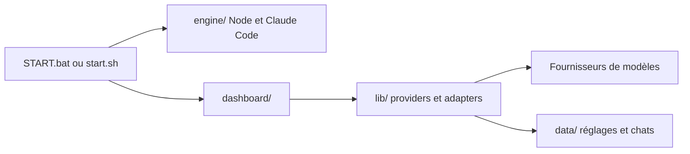

# techjarves/OpenClaude-Portable

> Portable Claude Code workspace on a USB stick, pluggable into nine model providers.

## The problem
Using Claude Code without a global installation, with models other than Anthropic's, from any folder or machine.

## What it actually does
A launcher (`START.bat` or `start.sh`) downloads Node.js and installs the official Claude Code and Agent SDK packages into `engine/`. A local web dashboard and a Claude Code terminal plug into NVIDIA NIM, DeepSeek, OpenRouter, Gemini, Anthropic, OpenAI, Ollama, LM Studio or a custom API. Settings, history and caches stay in the project folder.

## How it is wired


## Trying it
```bash
chmod +x start.sh
./start.sh
bash start.sh local-setup
```

## Cost and gotchas
API keys for the chosen provider are at your expense. Keys are stored in plain text in `data/settings.json`: protect the USB stick. An internet connection is required on first launch.

## What it is not
Not a sandbox leaving no trace on the host machine, and not a replacement for Claude Code: it wraps the official tool. Local models require a lot of RAM or VRAM.

## Alternatives
No alternative named in the README.

## For you
Worth watching: handy for trying Claude Code with other models, but plain-text keys and a single maintainer limit serious use.
