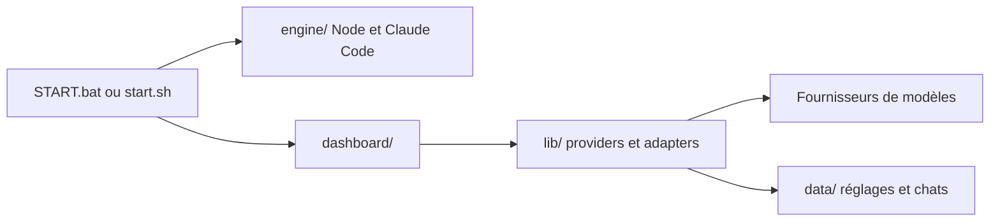

# techjarves/OpenClaude-Portable

> Espace de travail Claude Code portable sur clé USB, branchable sur neuf fournisseurs de modèles.

## Le problème
Utiliser Claude Code sans installation globale, avec d'autres modèles que ceux d'Anthropic, depuis n'importe quel dossier ou poste.

## Ce que ça fait vraiment
Un lanceur (`START.bat` ou `start.sh`) télécharge Node.js et installe les paquets officiels Claude Code et Agent SDK dans `engine/`. Un tableau de bord web local et un terminal Claude Code se branchent sur NVIDIA NIM, DeepSeek, OpenRouter, Gemini, Anthropic, OpenAI, Ollama, LM Studio ou une API personnalisée. Réglages, historique et caches restent dans le dossier du projet.

## Comment c'est branché


## Essayer
```bash
chmod +x start.sh
./start.sh
bash start.sh local-setup
```

## Coût et pièges
Clés d'API du fournisseur choisi à ta charge. Les clés sont stockées en clair dans `data/settings.json` : protège la clé USB. Une connexion internet est requise au premier lancement.

## Ce que ce n'est pas
Pas un sandbox sans trace sur la machine hôte, et pas un remplaçant de Claude Code : il emballe l'outil officiel. Les modèles locaux exigent beaucoup de RAM ou de VRAM.

## Alternatives
Aucune alternative nommée dans le README.

## Pour toi
À surveiller : pratique pour essayer Claude Code avec d'autres modèles, mais les clés en clair et un mainteneur unique limitent l'usage sérieux.

