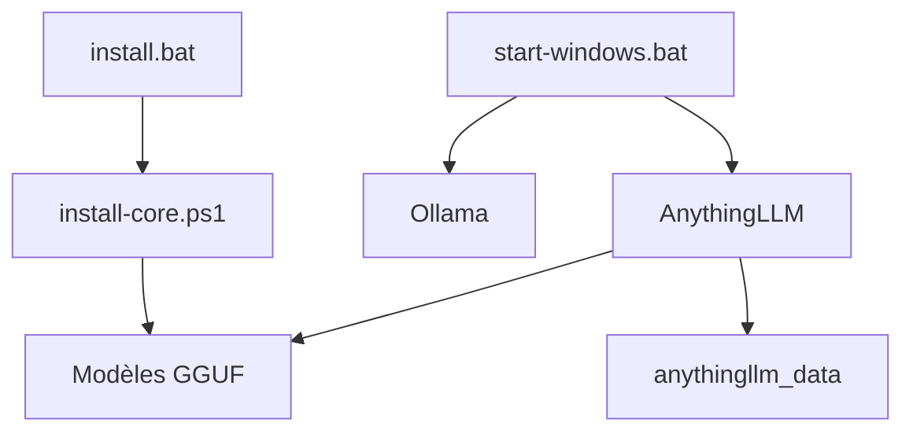

# techjarves/Portable-AI-USB

> Kit that installs a local Ollama and AnythingLLM assistant on a USB stick, with no connection needed after installation.

## The problem
Running a local language model on several PCs without leaving anything on the host machine requires a manual setup.

## What it actually does
Scripts (`install.bat`, `install.sh`) download Ollama, GGUF models (NemoMix 12B, Dolphin Llama 3, Mistral 7B, Qwen 2.5, Llama 3.2, Phi-3.5 or a custom model) and the AnythingLLM interface onto the stick. Per-system launchers start everything; conversations stay on the stick. Inference runs on the CPU.

## How it is wired


## Trying it
```bash
chmod +x start-linux.sh preflight-check.sh install.sh install-core.sh
bash preflight-check.sh
```
On Windows: double-click `install.bat` then `start-windows.bat`.

## Cost and gotchas
Free. USB stick of at least 16 GB in exFAT, 8 GB of RAM for the 12B model; answers in 10 to 30 seconds on CPU. The repository is deprecated in favour of Uncensored-Local-Studio. "Uncensored" models are offered.

## What it is not
It is not a maintained project. It is not fast: everything runs on the processor. The README provides no proof of the advertised "zero trace".

## Alternatives
Uncensored-Local-Studio, the successor designated by the README.

## For you
Ignore: deprecated, and a standard Ollama installation is enough for an AI profile.
