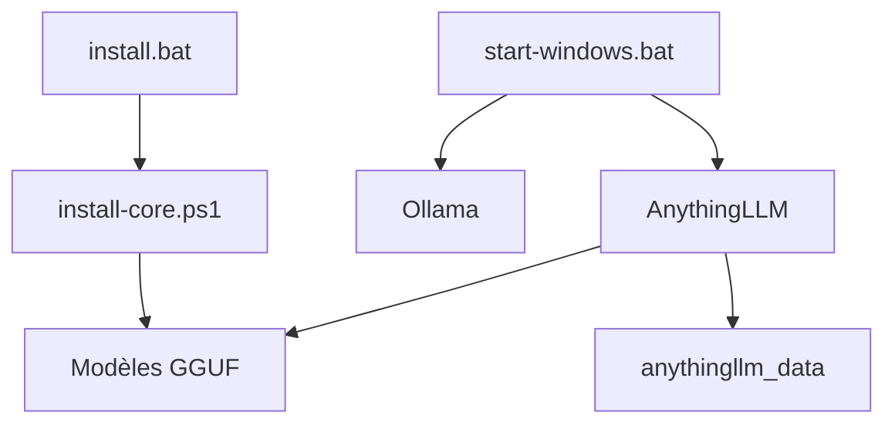

# techjarves/Portable-AI-USB

> Kit qui installe sur une clé USB un assistant local Ollama et AnythingLLM, sans connexion après installation.

## Le problème
Faire tourner un modèle de langage local sur plusieurs PC sans rien laisser sur la machine hôte demande un montage manuel.

## Ce que ça fait vraiment
Des scripts (`install.bat`, `install.sh`) téléchargent Ollama, des modèles GGUF (NemoMix 12B, Dolphin Llama 3, Mistral 7B, Qwen 2.5, Llama 3.2, Phi-3.5 ou un modèle personnalisé) et l'interface AnythingLLM sur la clé. Des lanceurs par système démarrent le tout ; les discussions restent sur la clé. Inférence sur CPU.

## Comment c'est branché


## Essayer
```bash
chmod +x start-linux.sh preflight-check.sh install.sh install-core.sh
bash preflight-check.sh
```
Sous Windows : double-clic sur `install.bat` puis `start-windows.bat`.

## Coût et pièges
Gratuit. Clé USB d'au moins 16 Go en exFAT, 8 Go de RAM pour le modèle 12B ; réponses en 10 à 30 secondes sur CPU. Le dépôt est déprécié au profit de Uncensored-Local-Studio. Des modèles « non censurés » sont proposés.

## Ce que ce n'est pas
Ce n'est pas un projet maintenu. Ce n'est pas rapide : tout tourne sur le processeur. Le README n'établit pas de preuve du « zéro trace » annoncé.

## Alternatives
Uncensored-Local-Studio, le successeur désigné par le README.

## Pour toi
À ignorer : déprécié, et une installation Ollama classique suffit à un profil IA.

