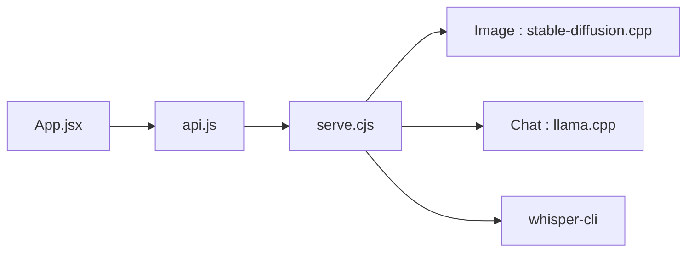

# techjarves/Portable-Local-Studio

> Portable local studio for Stable Diffusion images, LLM chat, Whisper transcription and Kokoro speech synthesis.

## The problem
Installing stable-diffusion.cpp, llama.cpp, whisper.cpp and a TTS separately, with the right GPU backends, is tedious.

## What it actually does
A launcher (`windows.bat`, `linux.sh`, `mac.sh`) downloads a portable Node.js and the matching binaries (CUDA, ROCm, Vulkan, Metal, OpenVINO NPU). React interface on `localhost:1420`: image generation (SD 1.5, SDXL), GGUF chat, transcription, Kokoro voice, a model manager using Hugging Face URLs, and a CPU/RAM/VRAM monitor. Image and text are mutually exclusive by default to spare memory.

## How it is wired


## Trying it
```bash
chmod +x linux.sh
./linux.sh
./linux.sh --max-perf
./linux.sh --setup-openvino
```

## Cost and gotchas
Free, but model weights take several GB. Linux: glibc 2.38+ required. macOS: Apple Silicon only. Flux, LoRA and ControlNet are not supported.

## What it is not
Not a production tool nor a ComfyUI replacement: single-file models only. The README claims there is no telemetry; not verified here.

## Alternatives
No alternative named in the README.

## For you
Worth watching: handy for trying local models without installation, but young (June 2026) and limited in supported models.
