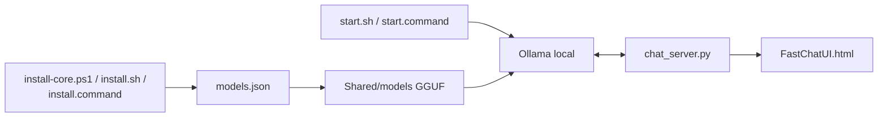

# techjarves/USB-Uncensored-LLM

> Portable local LLM environment on a USB stick, shipped with models that have no safety filter.

## The problem
Running a local LLM on several machines (Windows, macOS, Linux, Android) requires installing the engine and models each time.

## What it actually does
Per-OS installation scripts download an Ollama engine into `Shared/bin`, then GGUF models into `Shared/models`, shared between systems. A Python HTTP server (`chat_server.py`) serves a chat interface (`FastChatUI.html`) also reachable from a phone on the same network. The catalog offers "abliterated" or "heretic" models, whose alignment safety has been removed.

## How it is wired


## Trying it
```bash
bash Linux/install.sh
bash Linux/start.sh
# Windows : Windows/install.bat puis Windows/start-fast-chat.bat
# macOS : Mac/install.command puis Mac/start.command
```

## Cost and gotchas
Free, but 8 GB of space minimum and 8 to 16 GB of RAM depending on the model. The repository is archived: the README points to `Uncensored-Local-Studio`. No license declared, so reuse rights are uncertain. LAN access has no documented authentication.

## What it is not
Neither maintained (archived, 37 open issues, Windows fixes moved elsewhere) nor "dependency-free" in the strict sense: it downloads the engine and models. Models without guardrails produce unfiltered output, including illicit output: responsibility for use falls on the user.

## Alternatives
`Uncensored-Local-Studio` (successor indicated by the README).

## For you
Ignore: archived repository, no license, and a mere wrapper around Ollama; for portable local LLMs, start from the successor or from Ollama directly.
