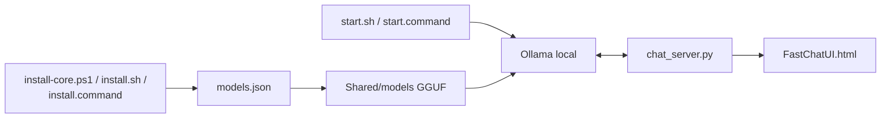

# techjarves/USB-Uncensored-LLM

> Environnement de LLM local portable sur clé USB, livré avec des modèles sans filtre de sécurité.

## Le problème
Faire tourner un LLM local sur plusieurs machines (Windows, macOS, Linux, Android) demande d'installer moteur et modèles à chaque fois.

## Ce que ça fait vraiment
Des scripts d'installation par OS téléchargent un moteur Ollama dans `Shared/bin`, puis des modèles GGUF dans `Shared/models`, partagés entre systèmes. Un serveur HTTP Python (`chat_server.py`) sert une interface de chat (`FastChatUI.html`) accessible aussi depuis un téléphone du même réseau. Le catalogue propose des modèles « abliterated » ou « heretic », dont la sécurité d'alignement a été retirée.

## Comment c'est branché


## Essayer
```bash
bash Linux/install.sh
bash Linux/start.sh
# Windows : Windows/install.bat puis Windows/start-fast-chat.bat
# macOS : Mac/install.command puis Mac/start.command
```

## Coût et pièges
Gratuit, mais 8 Go d'espace minimum et 8 à 16 Go de RAM selon le modèle. Le dépôt est archivé : le README renvoie vers `Uncensored-Local-Studio`. Aucune licence déclarée, donc droits de réutilisation incertains. L'accès LAN est sans authentification documentée.

## Ce que ce n'est pas
Ni maintenu (archivé, 37 issues ouvertes, correctifs Windows déplacés ailleurs) ni « sans dépendance » au sens strict : il télécharge moteur et modèles. Les modèles sans garde-fous produisent des sorties non filtrées, y compris illicites : la responsabilité d'usage revient à l'utilisateur.

## Alternatives
`Uncensored-Local-Studio` (successeur indiqué par le README).

## Pour toi
À ignorer : dépôt archivé, sans licence, et un simple emballage d'Ollama ; pour du LLM local portable, pars du successeur ou d'Ollama directement.

