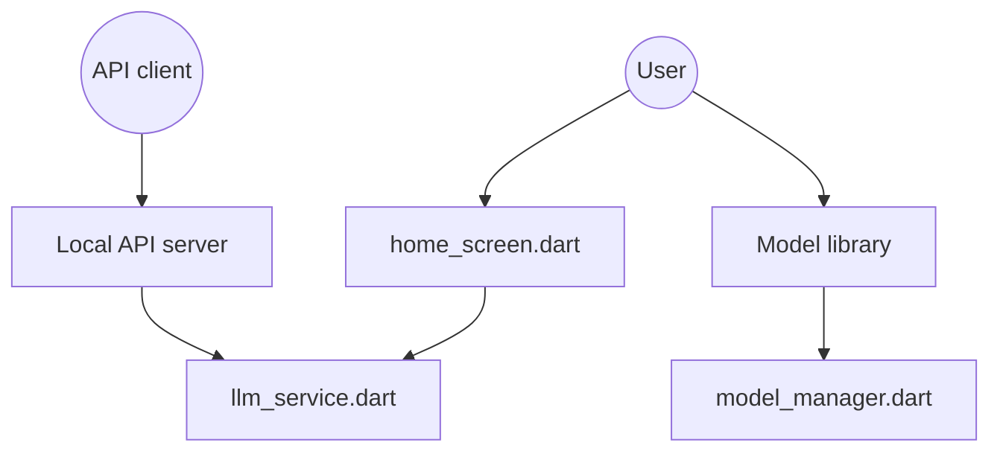

# techjarves/Uncensored-Local-AI-Multiplatform

> Flutter application that runs unfiltered GGUF models on a phone, with a local API.

## The problem
Using an LLM on mobile without cloud or subscription, with unrestricted models.

## What it actually does
Flutter app (Android APK, iOS IPA in pre-release): downloads or imports GGUF models from a Models tab, loads them through an LLM service, and chats locally with history stored via Hive. An OpenAI-compatible HTTP server can be enabled in the settings (`127.0.0.1:4891/v1`). Tokens/s metrics are displayed.

## How it is wired


## Trying it
```bash
curl http://127.0.0.1:4891/v1/models
curl http://127.0.0.1:4891/v1/chat/completions -H "Content-Type: application/json" -d '{"model":"local","messages":[{"role":"user","content":"Bonjour"}]}'
```
On iOS: `flutter pub get`, `flutter build ios --release`.

## Cost and gotchas
Free; installed outside the stores (APK, TrollStore/AltStore). Models of ~1.6 to 5.3 GB: phone storage and RAM. Flutter file sources were not sampled.

## What it is not
Not a product published on the stores; iOS is in pre-release, desktop untested. "No censorship" is a selling point, not a verifiable guarantee. No license declared: reuse of the code is not permitted as it stands.

## Alternatives
None cited in the README.

## For you
Ignore: no license and a single person; for local LLM on mobile with an OpenAI API, you need a reusable base, which is not the case here.
