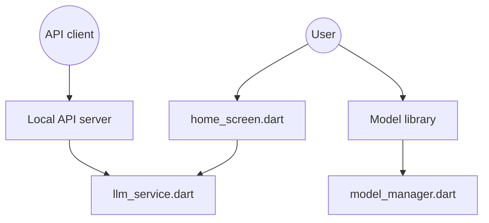

# techjarves/Uncensored-Local-AI-Multiplatform

> Application Flutter qui fait tourner des modèles GGUF sans filtre sur téléphone, avec une API locale.

## Le problème
Utiliser un LLM sur mobile sans cloud ni abonnement, avec des modèles débridés.

## Ce que ça fait vraiment
App Flutter (Android APK, iOS IPA en pré-version) : télécharge ou importe des modèles GGUF depuis un onglet Models, les charge via un service LLM, et discute en local avec historique stocké via Hive. Un serveur HTTP compatible OpenAI s'active dans les réglages (`127.0.0.1:4891/v1`). Métriques de tokens/s affichées.

## Comment c'est branché


## Essayer
```bash
curl http://127.0.0.1:4891/v1/models
curl http://127.0.0.1:4891/v1/chat/completions -H "Content-Type: application/json" -d '{"model":"local","messages":[{"role":"user","content":"Bonjour"}]}'
```
Côté iOS : `flutter pub get`, `flutter build ios --release`.

## Coût et pièges
Gratuit ; installation hors stores (APK, TrollStore/AltStore). Modèles de ~1,6 à 5,3 Go : stockage et RAM du téléphone. Sources des fichiers Flutter non échantillonnées.

## Ce que ce n'est pas
Pas un produit publié sur les stores ; iOS est en pré-release, desktop non testé. « Aucune censure » est un argument de vente, pas une garantie vérifiable. Aucune licence déclarée : réutilisation du code non autorisée en l'état.

## Alternatives
Aucune citée dans le README.

## Pour toi
Ignorer : pas de licence et une personne seule ; pour du LLM local sur mobile avec API OpenAI, il faut une base réutilisable, ce qui n'est pas le cas ici.

