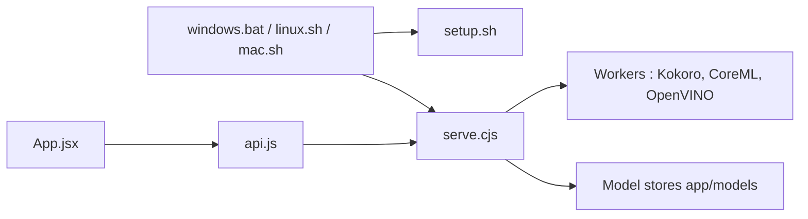

# techjarves/Uncensored-Local-Studio

> Offline local studio bundling image generation, LLM chat, transcription and speech synthesis, with no account or cloud.

## The problem
Assembling stable-diffusion.cpp, llama.cpp, whisper.cpp and Kokoro separately, with the right GPU backend, takes a lot of configuration. Cloud services require an account, a subscription and sending your data.

## What it actually does
- A React (Vite) interface serves as a simple control panel; `scripts/server/serve.cjs` starts and stops the native engines.
- Images via `stable-diffusion.cpp` (SD 1.5, SDXL), chat via a `llama.cpp` server (GGUF), speech recognition via `whisper-cli`, TTS via `kokoro-js`.
- Images and LLM are mutually exclusive by default to spare RAM and VRAM.
- Detects hardware: CUDA, ROCm, Vulkan, Metal, OpenVINO NPU or CPU; model manager by Hugging Face URL.

## How it is wired


## Trying it
```bash
chmod +x linux.sh
./linux.sh
./linux.sh --max-perf          # backend ROCm AMD
./linux.sh --setup-openvino    # NPU Intel
```
Then open `http://localhost:1420`. On Windows: double-click `windows.bat`; on macOS: `chmod +x mac.sh` then `./mac.sh`.

## Cost and gotchas
Free, no API key, but a GPU is recommended (CPU is very slow) and downloads are large (models of 2 to 6.6 GB). Linux: glibc 2.38+ required; macOS: Apple Silicon only.

## What it is not
Neither Flux, nor LoRA, nor ControlNet loaded alone: not supported. "Uncensored" refers to the absence of a filter in the application, not in the models: their license and the legal use of the generated content remain your responsibility. The README cites an MIT license but the catalog does not declare it.

## Alternatives
- leejet/stable-diffusion.cpp: the image engine used, if you only want that building block.
- llama.cpp and whisper.cpp: the engines directly, without a unified interface.

## For you
Keep an eye on it: handy for testing local models in one place, but a one-person project, license to be confirmed and little MLOps integration (no documented API).
