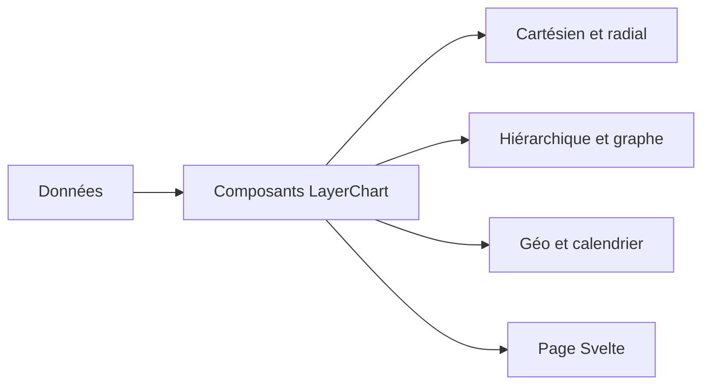

# techniq/layerchart

> Collection of composable Svelte chart components, for anyone building web visualizations.

## The problem
Assembling varied charts (maps, trees, graphs) in Svelte means stitching together several libraries.

## What it actually does
Svelte components for Cartesian charts (area, bars, lines, scatter), radial (radar, pie), hierarchical (treemap, tree), network (Dagre, Force, Sankey), geographic (choropleth, globe) and calendar. The README provided is very short.

## How it is wired
Simplified diagram based on the sheet, no diagram provided.



## Trying it
```bash
pnpm i
cd packages/layerchart
pnpm dev
```
These commands are for developing the package itself.

## Cost and gotchas
Free, MIT license. The README does not document user-side installation.

## What it is not
Not a generic library: it assumes Svelte. It does not provide a turnkey dashboard.

## Alternatives
Svelte UX, a companion library cited in the README, for application components.

## For you
Worth watching: interesting if you build data dashboards in Svelte, of no interest if your stack is Python or React.
