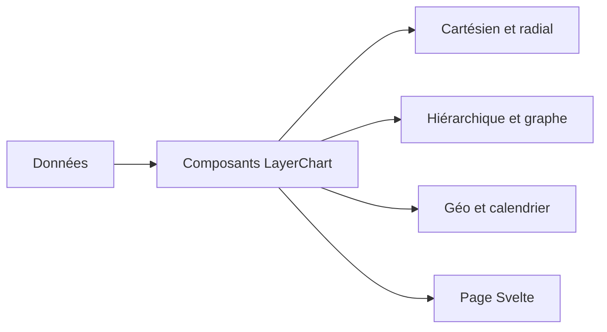

# techniq/layerchart

> Collection de composants de graphiques Svelte composables, pour qui construit des visualisations web.

## Le problème
Assembler des graphiques variés (cartes, arbres, graphes) en Svelte demande de recoller plusieurs bibliothèques.

## Ce que ça fait vraiment
Composants Svelte pour les graphes cartésiens (aire, barres, lignes, nuage de points), radiaux (radar, secteurs), hiérarchiques (treemap, arbre), de réseau (Dagre, Force, Sankey), géographiques (choroplèthe, globe) et calendrier. Le README fourni est très court.

## Comment c'est branché
Schéma simplifié d'après la fiche, sans diagramme fourni.



## Essayer
```bash
pnpm i
cd packages/layerchart
pnpm dev
```
Ces commandes servent au développement du paquet lui-même.

## Coût et pièges
Gratuit, licence MIT. Le README ne documente pas l'installation côté utilisateur.

## Ce que ce n'est pas
Pas une bibliothèque générique : elle suppose Svelte. Elle ne fournit pas de tableau de bord clé en main.

## Alternatives
Svelte UX, bibliothèque compagnon citée dans le README, pour des composants d'application.

## Pour toi
À surveiller : intéressant si tu fais des tableaux de bord data en Svelte, sans intérêt si ta pile est en Python ou React.

