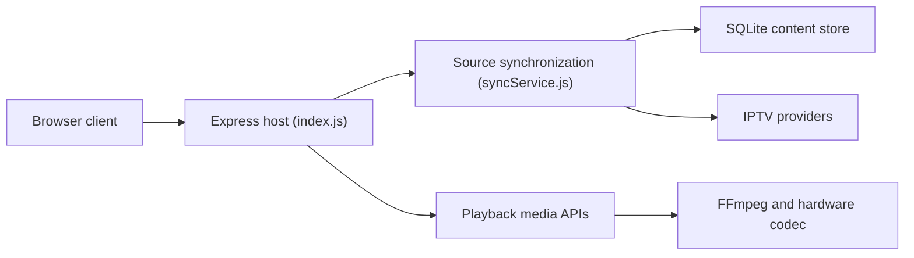

# technomancer702/nodecast-tv

> Self-hosted web IPTV player (live, program guide, movies, series) with hardware transcoding.

## The problem
Watching your IPTV streams (Xtream Codes, M3U) often requires several applications depending on the device.

## What it actually does
Node/Express server with SQLite, a pure JavaScript client and HLS.js. Imports Xtream or M3U sources, an XMLTV EPG guide, favorites, admin/viewer roles and OIDC authentication. FFmpeg transcoding with NVENC, AMF, QuickSync, VAAPI, automatic remux, 5.1-to-stereo audio mixing presets. A proxy works around CORS and mixed content.

## How it is wired


## Trying it
```bash
git clone https://github.com/technomancer702/nodecast-tv.git
cd nodecast-tv
npm install
npm run dev
docker-compose up -d
```
Then http://localhost:3000.

## Cost and gotchas
Free, but you must supply an IPTV subscription or source. Hardware transcoding requires exposing the GPU to the container. Last push in March 2026 (less than a year ago).

## What it is not
Not a content provider: no channel is supplied. The legality of the sources is up to you.

## Alternatives
No alternative named in the README (Threadfin, xTeVe, dispatcharr are compatible middleware).

## For you
Ignore: a media player unrelated to data or AI.
