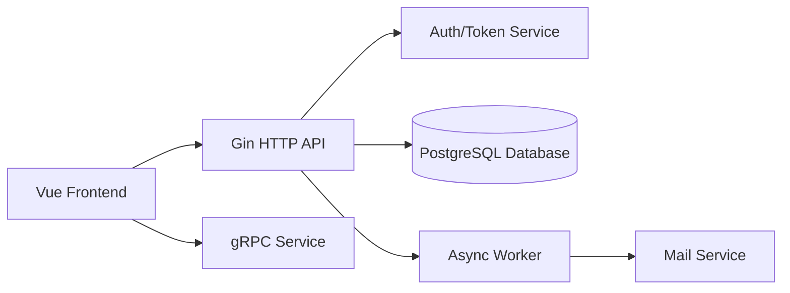

# techschool/simplebank

> Code for the "Backend Master Class" course: a banking service in Go, from the basics to EKS deployment.

## The problem
Learning backend development end to end (transactions, auth, gRPC, deployment) from fragmented tutorials is hard.

## What it actually does
A simple bank service: accounts, entries, transfers within a SQL transaction.
Covers sqlc, migrations, Gin REST, JWT/PASETO, gRPC + gateway, Asynq/Redis workers, emails.
Deployment with Docker, AWS ECR/RDS/EKS, Ingress, Let's Encrypt, GitHub Actions.
Accompanies 77 video lessons (Udemy) and a Vue.js mini-course.

## How it is wired


## Trying it
```bash
make network
make postgres
make createdb
make migrateup
make sqlc
make server
make test
```

## Cost and gotchas
Free locally; AWS EKS/RDS deployment is billed (one lesson is devoted to it).
Last push in April 2025.

## What it is not
Not a library or a product: teaching material.
Not Python or data.

## Alternatives
No alternative named in the README.

## For you
Ignore for data/AI watch: excellent Go backend course, but outside your scope and no longer updated.
