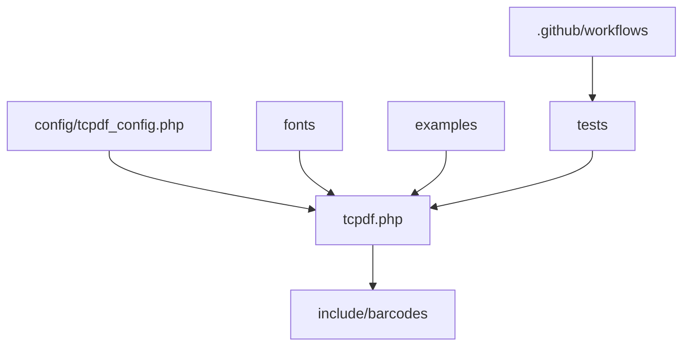

# tecnickcom/TCPDF

> PHP library for generating PDFs and barcodes, now in maintenance-only mode.

## The problem
PHP applications need to produce PDFs (invoices, reports, barcodes) directly from code.

## What it actually does
Since version 7, the `TCPDF` class is a compatibility facade: every public method delegates to `tecnickcom/tc-lib-pdf`, with a small internal state reproducing the cursor and pages of the old API. The output is equivalent but not byte-for-byte identical. Fonts come from `tc-lib-pdf-font`, and remote loading is disabled by default.

## How it is wired
Diagram based on the supplied schema.



## Trying it
```bash
make deps
make fonts
make qa
```

## Cost and gotchas
Free. LGPL v3 license according to the README but "unidentified" for GitHub. PHP 8.2 and ext-curl required, fonts to generate at install. Breaking changes: legacy fonts removed, EPS/AI import dropped.

## What it is not
Not a base for a new project: the repository is deprecated and points to tc-lib-pdf. No output identical to the old version.

## Alternatives
- tc-lib-pdf: the modular successor, to be preferred for any new project.

## For you
Ignore: deprecated, PHP and maintenance-only; for data-side PDFs, use a tool from your ecosystem, or tc-lib-pdf if PHP is imposed.
