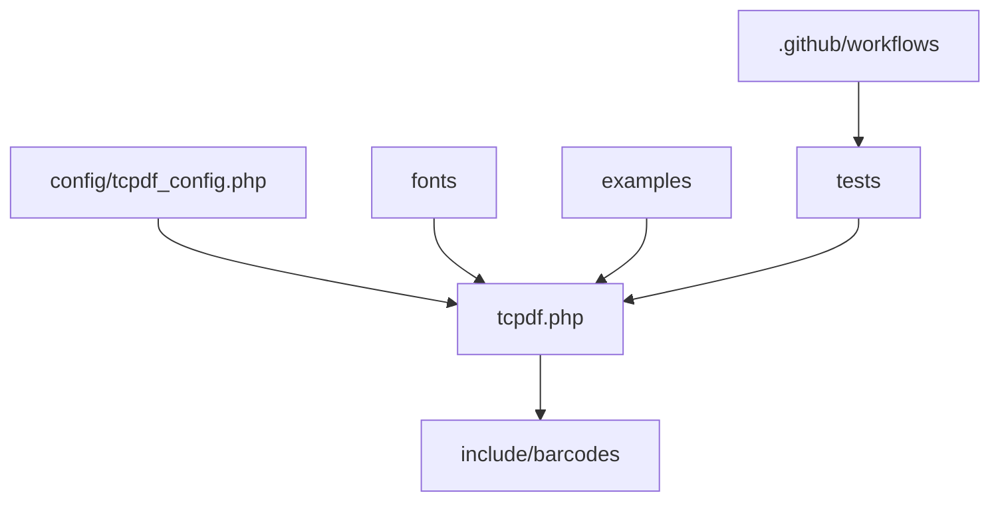

# tecnickcom/TCPDF

> Bibliothèque PHP de génération de PDF et de codes-barres, désormais en maintenance seule.

## Le problème
Les applications PHP doivent produire des PDF (factures, rapports, codes-barres) directement depuis le code.

## Ce que ça fait vraiment
Depuis la version 7, la classe `TCPDF` est une façade de compatibilité : chaque méthode publique délègue à `tecnickcom/tc-lib-pdf`, un petit état interne reproduisant le curseur et les pages de l'ancienne API. La sortie est équivalente mais pas identique octet pour octet. Les polices viennent de `tc-lib-pdf-font`, le chargement distant est désactivé par défaut.

## Comment c'est branché
Schéma d'après le diagramme fourni.



## Essayer
```bash
make deps
make fonts
make qa
```

## Coût et pièges
Gratuit. Licence LGPL v3 selon le README mais « non identifiée » pour GitHub. PHP 8.2 et ext-curl requis, polices à générer à l'installation. Changements incompatibles : plus de polices héritées, import EPS/AI abandonné.

## Ce que ce n'est pas
Pas une base pour un nouveau projet : le dépôt est déprécié et renvoie vers tc-lib-pdf. Pas de sortie identique à l'ancienne version.

## Alternatives
- tc-lib-pdf : le successeur modulaire, à préférer pour tout nouveau projet.

## Pour toi
À ignorer : déprécié, PHP et en maintenance seule ; pour des PDF côté données, passe par un outil de ton écosystème ou par tc-lib-pdf si PHP est imposé.

