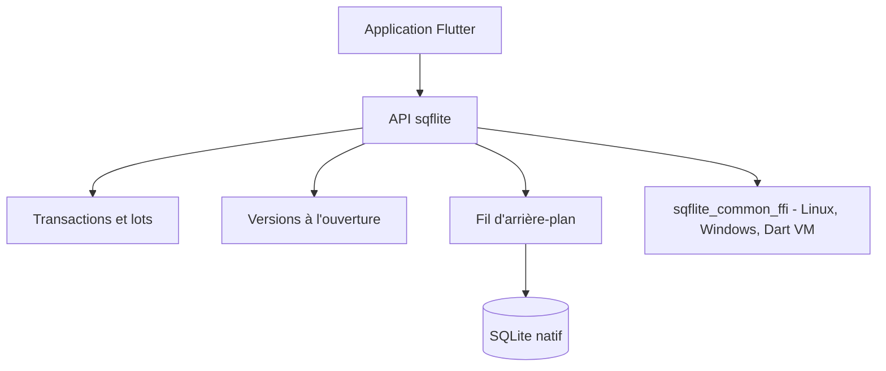

# tekartik/sqflite

> SQLite plugin for Flutter applications on iOS, Android and macOS.

## The problem
A Flutter application that keeps its data locally needs native SQLite access from Dart.

## What it actually does
The plugin handles transactions and batches, automatic version management on open, and helpers to insert, read, update and delete. Operations run in a background thread on iOS and Android. Linux, Windows and the Dart VM go through `sqflite_common_ffi`. The README is only a few lines long: the rest is in the external documentation.

## How it is wired
Simplified diagram based on the sheet, no diagram provided.

## Trying it
No command documented in the README (links to documentation, API reference and guide).

## Cost and gotchas
Free. Insufficient material: installation and examples are not in the README, you have to open the external documentation.

## What it is not
It is not an ORM nor a synchronization solution: it is SQLite access with a few query helpers. It does not target the web.

## Alternatives
No alternative named in the README.

## For you
Ignore: useful only for Flutter mobile development, outside the data, AI or MLOps scope.
